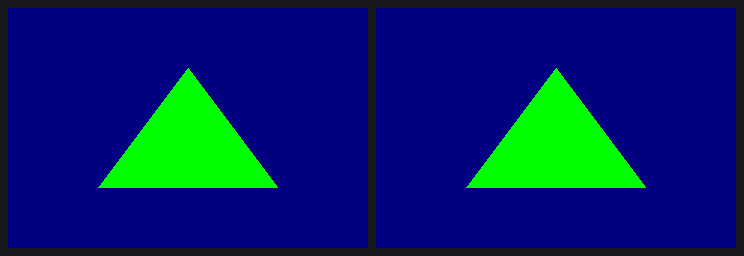
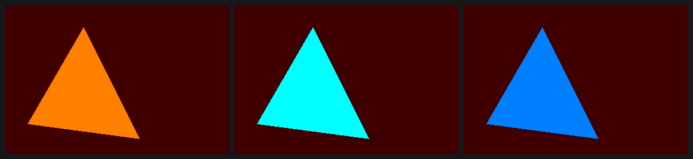
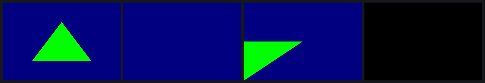
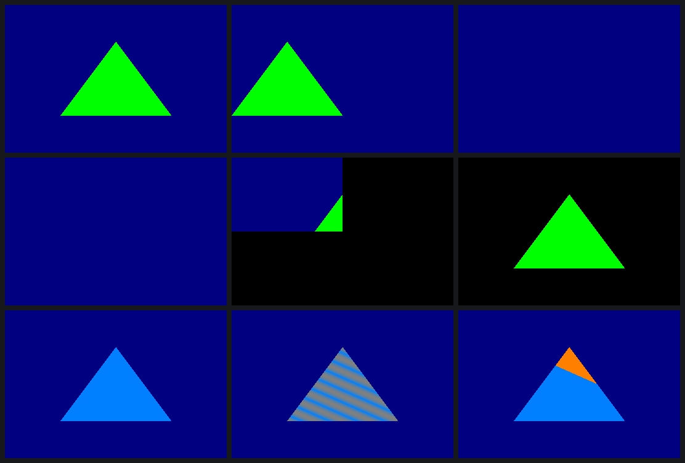
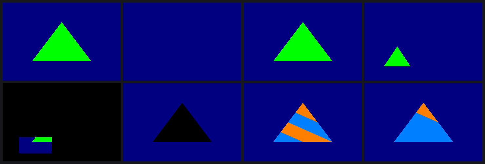
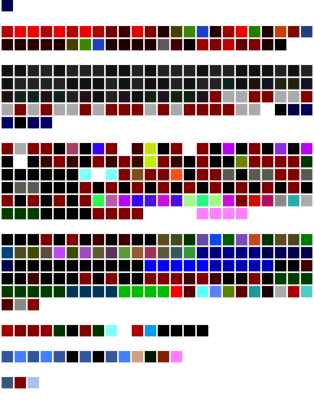
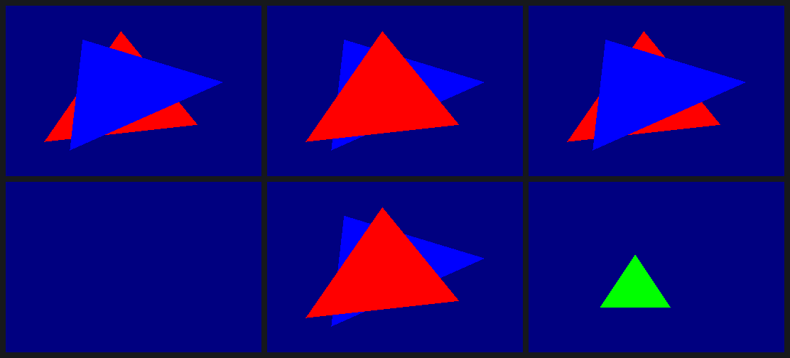

# Opening the SGX545: build log

The Control4 EA controllers (Intel CE5300) carry a PowerVR SGX545 GPU. The only userspace
that has ever driven it is Intel's closed i386 Cedarview DDK 1.7 (`1.7@862890`). openHC
runs it on a 64-bit system through the kernel's IA32 compat layer, and that blob is what
renders the Minecraft session on the EA1 today, through gl4es.

This log tells how an open, native x86_64 userspace for that GPU came together, starting
2026-10-28 00:40 UTC. Times are UTC. Every frame shown here was read back from the GPU of
an EA3 on the bench (10.0.0.113). Per-milestone entries live in `entries/`, the figures
in `img/`, and the raw numbers in `data/`.

**Where it stands.**
- At 05:53 the GPU was brought up by our own init code and rendered a frame submitted by
  our own x86_64 program, with no Intel code loaded at any point.
- The command stream, render state, PDS programs and USSE shader instruction set are
  decoded well enough to author frames by hand.
- At 08:15 a frame built entirely from code (`tools/gen`, no captured bytes) matched the
  blob's reference frame bit for bit. Ten variations (colours, two draws, depth tests, a
  viewport, other surface sizes) matched the blob's own rendering with 0 pixels different.
- What remains is turning that into a compiler and a Mesa driver.

| | |
|---|---|
| GPU | PowerVR SGX545, revision 1.0.14 (HW core rev 1000e) |
| Blob replaced | Intel Cedarview DDK 1.7.862890, i386 |
| Test box | EA3 (CE5315), openHC, Linux 7.1.8, sgx545ce driver built in |
| Frame | 720×480; back buffer BGRA8888 at device address `0x3e265000`, pitch 736 |
| Branch | sgx545-ce `um-re` (local) |


---

## 1. Watching the blob (00:40–01:05)

The first tool was a tracer, `tools/trace/pvrtrace.c`. It is an `LD_PRELOAD` library that
logs every PVR services bridge call (one DRM ioctl, `0x40+0x12`, carrying an IN and an OUT
buffer). Before each `SGX_DOKICK` it also copies every buffer of GPU memory the process has
mapped.

The first traced `gles2tri` produced 445 bridge calls and **not one mapping**. The cause
showed up in `nm -D --undefined-only libsrv_um.so`, which lists `syscall@GLIBC_2.0` next to
`mmap64`: libsrv_um maps GPU memory with a raw `syscall(__NR_mmap2)`, passing a kernel cookie
as the page offset. Once the tracer hooked `syscall()` too, the next capture held 445 calls,
434 memory snapshots and 217 mappings (20.5 MB).

Two pieces of groundwork made the bytes readable:

- **Struct layouts with no hand-written offsets.** clang's record-layout dump ran over the
  GPL kernel headers with the driver's own defines, once for i386 and once for x86_64 (248
  and 249 records). The bridge package is 28 bytes on i386 and 48 on x86_64.
- **Bridge numbers read out of the compiler.** Which bridges exist depends on build flags.
  So `ids.sh` turns each `_IOC_NR(PVRSRV_BRIDGE_X)` into the size of a `char` array and
  reads the sizes back with `nm`, giving 105 ID-to-name pairs. The previously unnamed
  `bridge109` turned out to be `SGX_REGISTER_HW_TRANSFER_CONTEXT`.

Then came a probe program that draws one triangle, with every input (colour, clear colour,
vertices, draw count) taken from the environment. Five captures that each change one input
gave the first decodes:

- A uniform `vec4` is stored as FP16 pairs, so green to red is a one-word change.
- The clear is a background object: three screen-space vertices with an ARGB colour.
- VDM control-stream words carry a type in the top nibble and an address shifted right by 4.
- `glDrawArrays` becomes an indexed draw over a static identity index buffer.

| Heap | Device base |
|---|---|
| general | `0x3e000000` |
| TA data | `0x20000000` |
| kernel code / data | `0x30000000` / `0x32000000` |
| pixel / vertex shader | `0x37000000` / `0x3c000000` |
| PDS pixel / vertex | `0x2e000000` / `0x30400000` |
| sync | `0x2d000000` |
| 3D parameters | `0x10000000` |
| texture | `0xf0000000` |

One frame is two kicks. Kick 1 (`bFirstKickOrResume`) comes from `glFinish`. The render
itself happens on kick 2 (`bLastInScene`), which `glReadPixels` triggers.

## 2. A frame with no blob (01:39–02:20)

Translating each i386 bridge struct to x86_64 byte by byte was tried and dropped. In its
place came a small typed client on the GPL headers, `libpvr/pvr.c`: connect, memory
context, allocate and map, wrap, register a render context, kick. `mkreplay.py` turns a
capture into a script for it: 1,485 operations, 27,212 bytes of data, 196 buffers.
`replay` is a static x86_64 musl binary. It loads no Imagination library.

The first run on the EA3 died with:

```
replay:5: map of buffer 0 failed
PVR_K:(Error): DoMapToUser: Error - VM_INSERT_PAGE failed (-14)
```

The driver walks the user mapping with an `IMG_UINT32`, so a 64-bit process that maps
above 4 GB gets a truncated address. The i386 blob never hits this. With `MAP_32BIT` as a
workaround, the second run worked. After the BGRA-to-RGBA swap, the vertical flip and the
pitch, the result was **0 of 345,600 pixels different** from the blob's own frame, the same
md5 (`56f8466a…`) on 4 of 4 runs.



The real fix (`28e6686`) widens three places in the driver: the DoMapToUser VMA walk,
`OSAcquirePhysPageAddr` on the wrap path, and the mmap offset struct. It was pushed as a
test branch with an openHC CI image. That kernel has not been booted yet, so for now native
clients still use `MAP_32BIT`.

## 3. Drawing our own (03:13–03:20)

The replayer gained `--verts`, `--clear`, `--color`, `--poke` and `--usse`. The last one
writes hand-assembled shader instructions into the captured frame. The assembler
(`tools/isa/asm.py`) reproduces all 9 encodings the compiler had produced, bit for bit.

- An authored triangle, clear colour and uniform matched the blob drawing the same inputs:
  0 of 345,600 pixels.
- Two hand-written `pck.u8.f32` instructions made the triangle cyan.
- One `fmad16 pa9, -pa9, c45, c45` in front of them computed `1 − c`.



## 4. The PDS (03:14–05:56)

Before each shader task, a tiny undocumented processor called the PDS runs a program. That
program DMAs vertex data, sets up varyings, hands texture state to the texture unit and
starts the USSE shader.

The halt word `af000000` shows up 9 times as an immediate in each of four DDK libraries.
That pointed to one PDS code generator linked into all of them. It is plain C that ORs
shifted fields into literal base words, so a decompile gives the field positions directly.
`tools/pds/dis.py` now disassembles all 13 captures (117–125 instructions each) with no
unexplained bit.

This is the triangle's vertex fetch, as `dis.py` prints it, with notes. The GL driver
generates it at draw time.

```
mul16 ds1[0x32], in0.lo, ds1[0].lo                     ; temp = vertex index * stride (8)
movs.x2.s27 doutd, ds0[0], ds0[1], ds1[0x32], ...      ; DMA 2 dwords from 0x3e51d030 + temp into attr 0
movs.cc3 doutu, ds0[2], ds0[3], ds1[1], ds1[1]         ; start the vertex shader at 0x3c008d80
halt
```

The open bits were settled by replaying the frame with one PDS word poked:



Replay C set bit 26 of the vertex program's `doutu` (`030403e5` → `070403e5`). It locked up
the tiling accelerator, and recovery could not bring it back:

```
PVR_K:(Error): SGXOSTimer() detected SGX lockup (0x10f16 tasks)
PVR_K: HWRecoveryResetSGX: SGX Hardware Recovery triggered
PVR_K:(Error): HWRecoveryResetSGX: SGXInitialise failed (24)
```

Recovery then looped about once a second: 35 triggers in 45 seconds. Only a power cycle
clears that. The EA3 is on a TP-Link HS110 smart plug called Bench, and a small script
drives it over the plug's local protocol. The box was back 54 seconds after the cycle.
From then on the rule was one poked replay at a time, with a dmesg check in between.

## 5. Render state (04:34–05:51)

The GPL headers name no ISP, TSP or PBE registers, so every field was named from the code
that writes it and then proven on the GPU. The state is spread across five places:

- the client part of the TA command;
- the VDM control stream;
- a DMA'd TA state block;
- the end-of-tile USSE program;
- kernel-side structures for the parameter buffer, render details and render target.

`tools/state/decode.py` follows all five and annotates every word. The 70 captures decode with
no unknown words.

Some of it is not where you would expect:

- **Scissor.** There is no scissor rectangle. The driver draws pass-type-3 objects with a
  tile-granular clip.
- **Blending.** It is mostly shader code the driver appends; the state block only carries
  a pass type.
- **Render target.** Its address, stride and clip are four words that the end-of-tile
  program loads with immediate instructions.

Each decoded field was proven the same way: change one word, predict the frame, compare.
All 12 replays matched their prediction to the pixel.



The DDK's own frames, captured while varying one GL call at a time, are the ground truth
the predictions were checked against:



The details (texture format codes, filter and wrap bits, stencil words) are in
`docs/STATE.md`. The replay table is in `data/story-state-replays.csv`.

## 6. The shader instruction set (02:28–06:54)

USSE instructions are 64 bits wide. The compiler, libusc, carries `useasm.c` (the hardware
encoder) inside it. That made the encoder the oracle:

1. **Hooking the encoder on the box.** `encfuzz.c` hooks the encoder during real compiles on
   the EA3 and re-encodes every instruction with single bits flipped.
2. **Running it on the Mac.** `oracle.py` loads libusc into a unicorn i386 emulator and calls
   the encoder directly. It reproduced 5,045 of the 5,056 encodings logged on the EA3. The
   other 11 are branches whose labels resolve through callbacks.
3. **Sweeping it.** About 20,000 oracle-checked encodings later, `tools/isa/hw.py` describes
   172 instruction forms covering all 32 hardware opcodes. All 4,154 instructions in the
   552-shader corpus decode with no unexplained bit and re-encode identically.

The encoder only says where the bits go, not what the hardware does with them. For that,
`hwt.py` patches a hand-assembled program into the captured frame. The program ends in
`mov o0, rN`, so every pixel of the triangle is the 32-bit register value. That made 442
draws: run twice, identical both times, with no hang.

A few results the documentation would not have told you:

- `fsin` and `fcos` take quarter turns: they compute sin/cos(t·π/2), to about 16 bits.
- F16 source numbers count 16-bit halves, so `r1.f16` is the high half of `r0`.
- Hardware constants c46 and c47 are the FP16 pair (1, 1), not the 0.5 and 1.0 in
  libusc's own table, and c57–c63 exist.
- f32-to-f16 packing always truncates, whatever rounding mode is set.




`normalize()` is where the decoder caught a real bug. The first line is a dual-issued
instruction whose secondary `mov` takes a single source selector:

```
fdual.fssq.mov o0, pa2, pa0, pa1  [sd=i2 msrc=src0]   ; o0 = x² + y², and i2 = z
fdual.mov.fmad o3, r0, c52, o0                         ; add z²
frsq o1, i2                                            ; 1/sqrt
smlsi …                                                ; per-operand register increments
fmad o0, pa0, o1, -c48  [rpt=3 moe]                    ; scale all three components
```

`discard` is not in the compiled shader at all. GLSL compiles it to a `test` and a
placeholder `nop`. At draw time the driver turns the program into two phases and swaps the
`nop` for `atst8 … [end]`.

## 7. Bringing the GPU up ourselves (04:35–06:54)

Something has to load the microkernel before any of this runs. On openHC that was
`libsrv_init`'s `SrvInit()`, an i386 call made at boot. It can run only once per boot, so
every hardware test costs a power cycle of a box that other work is using.

The approach kept the hardware out of the loop for as long as possible:

1. **Trace it.** The real `SrvInit` was traced from a cold boot and decoded against a
   disassembly of the library. It makes 15 allocations and runs two init scripts of 2 and
   35 register writes. It also patches 9 instruction pairs in the microkernel with buffer
   addresses.
2. **Rebuild it offline.** `srvinit/srvinit.c` builds the same 15 buffers. `srvinit -n`
   does it without touching the GPU, and `check.py` compared every buffer and every field
   of `SGX_BRIDGE_INIT_INFO` against the trace: all identical.
3. **One cold boot.** The first hardware boot failed:

```
PVR_K:(Error): pvr: invalid param size for IOCTL#99:
     kern/user in,out: 2192/2192,16/8
```

The driver registers `SGX_DEVINITPART2` with a 16-byte OUT on x86_64, but the handler writes
8. On i386 both are 8, so only a native caller trips it. With a 16-byte buffer, the next
boot worked:

```
== uptime 29.86, pvr-compat lines so far: 0
srvinit: SGX545 microkernel started (ukernel at 0x30000000, pd 0x01d0b000)
PVR_K: SysFinalise: SGX revision = 1.0.14
replay: back buffer IDENTICAL to the reference
```

"pvr-compat lines so far: 0" means no 32-bit bridge call had happened yet: only the static
x86_64 binary had talked to the driver. The replayed frame matched (md5 `56f8466a…`). After
it, the blob's own `gles2tri` still drew its green triangle, so GL clients keep working on
a GPU we brought up.

srvinit now also assembles the five small PDS programs that start the microkernel, byte for
byte the same as libsrv_init's. The only Imagination bytes it needs are the 53,096-byte
microkernel. `fetch-firmware.sh` extracts that from the user's own DDK; it is not in the
repository.

## 8. How the work was run

The work ran as parallel Claude Code sessions on one Mac, each in its own clone of `um-re`:

- replayer;
- PDS;
- render state;
- shader ISA, plus a finalizer trace and a hardware check;
- srvinit;
- one coordinating session.

They shared a single EA3 with a session working on the box's Ethernet switch driver.

- **Sharing the EA3.** Before a GPU run, each session messaged the others. Before any
  power cycle it waited for objections.
- **The EA1 was off limits.** It runs the live Minecraft session.
- **Power cycles.** Eight Bench-plug cycles were needed on the 28th (`data/story-power-cycles.csv`).
  One cleared the PDS wedge. One was lost because a file was not `sync`ed before the plug cut
  power. Three were srvinit's tests. Three cleared hangs of the first generated frames.

The milestone list is in `data/story-timeline.csv`.

## 9. A frame from code alone (07:50–08:30)

`tools/gen` (see `docs/GEN.md` and `entries/2026-10-28-0830-frame-from-code.md`) builds
every buffer of a frame from GL-level parameters:

- the PB and its free list;
- the RT data and render details;
- the TA command;
- the VDM stream and the TA state blocks;
- every PDS program, from PDS.md's encodings;
- every USSE program, from assembly text through `tools/isa`'s encoder.

It drew the reference triangle bit for bit (md5 `56f8466a…`).

Getting there took three power cycles, and two lessons:

- **The vertex epilogue.** A vertex program's `phas` points at a last phase
  (`emit.t1 [end f3_20]`); without it the TA hangs.
- **The previous client.** The microkernel keeps pointers to the previous
  client's render details and reads them at the next TA. A client with a
  different kernel-data layout hangs. `sgxgen` now allocates exactly like the
  DDK, which makes it safe next to blob clients and replays.

Checked against the blob drawing the same scenes:

- two draws;
- depth LESS/GREATER, with and without depth writes;
- a viewport;
- 128×48 and 320×200 surfaces.

All 0 pixels off.



## 10. Next

- **Generated shaders.** The NIR compiler backend fills `sgx_shader`. Then textures,
  blending, scissor and multi-frame contexts in `tools/gen`.
- **Test-boot the 64-bit DoMapToUser fix**, so native clients can map anywhere.
- **A compiler backend for USSE**, from NIR.
- **A Mesa gallium driver.**
- **Minecraft on the EA1, on that driver.**
