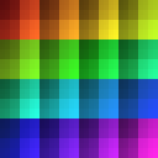
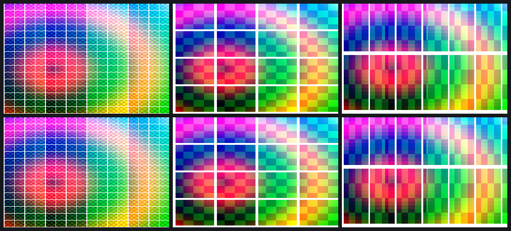

# Textures: where every texel goes, and our own layout on the GPU

So far every frame the open userspace drew was flat-shaded. Minecraft is
textured quads, so the next question was what a texture looks like in memory.
STATE.md already had the four texture words (format, size, filters, wraps),
but not the bytes the T2 address points at.

## Making textures name themselves

`tools/probe/probe.c` got `PROBE_TEXPAT`: every texel encodes its own
coordinates, mip level and cube face (RGBA8888: r = x, g = y, b = level |
face<<4; 16-bit formats: the linear index). Captured with pvrtrace on the
EA3, the texture buffer then says directly where each texel went, with no
pattern guessing. `tools/tex/rawmap.py` reads it back, `check.py` compares
every texel with the encoder's prediction.

29 layout captures (sizes 1×1 to 256×256, four NPOT sizes, seven formats,
mip chains, generated mipmaps, four cube maps), plus 14 more for the proofs
and render targets. The answers, all in `docs/TEX.md`:

- **Twiddled** (power-of-two sizes): 16×16 tiles, Morton order inside a tile
  with **y in the lowest bit**, tiles row-major. Up to 32×32 it is
  indistinguishable from plain Morton; 64×64 was the first size where bit 10
  turned out to be y4, not x5.
- **Linear** (NPOT): rows padded to 8 texels.
- **Formats**: bytes as GL uploads them, except RGBA4444 and RGBA5551, which
  the driver stores as ARGB (rotated), and RGB888, expanded to 8888.
- **Mips** packed back to back to 1×1; **cube faces** in GL order, packed for
  small faces, aligned for 16×16 and up.
- Every texel of every capture lands where `tex.py` says: 93,543 texels,
  none differ (`data/2026-10-28-0920-textures.csv`).

Figure 2 is the 64×64 capture's memory order, one colour per position in
memory (hue = 16×16 tile, brightness = position inside it):

## Uploads go through a hidden 3D render

There was one `SGX_SUBMITTRANSFER` per frame we had not explained, plus one
more per textured frame. The pvrtracer now snapshots memory before each
transfer, and that showed the GLES driver copying the linear image into a
staging buffer and letting the **transfer queue** twiddle it into the
texture: a 3D render with no geometry, only the background object, whose
pixel program samples the source and whose end-of-tile program writes the
destination with PBE sideband b13 = twiddled. Small textures (up to 256
texels) are twiddled by the CPU instead. `glGenerateMipmap` is the same
transfer once per level, and it turned out to be point sampling, not a box
filter.

`tools/tex/present.py` builds every word of such a transfer from the two
surfaces' sizes and addresses; all 17 transfers in the first captures
rebuild bit for bit (74 words each). `tools/tex/sgxtex.{h,c}` is the same
knowledge as dependency-free C for the Mesa driver, checked against the
Python on 103,146 values.

## The proof: our layout, the GPU's pixels

For three textures (256×256 RGBA8888 twiddled, 64×64 RGB565, 100×30
RGBA8888 linear) the DDK drew a test image once (the reference) and a
coordinate pattern once. The native replayer then replayed the *pattern*
capture with the test image laid out by `tex.py` written over the texture.
All three frames match the DDK's drawing of the image, **0 of 345,600
pixels**, while differing from the pattern frame in every pixel. Top row:
the DDK; bottom row: our replays.

Commits: `6cffe0b`, `208eac2`, `03d3745`, `ee84b3b` on `um-re` (the tex
work), then moved to `tools/tex` and `docs/TEX.md` (`da88290`) after the
repository restructure.
