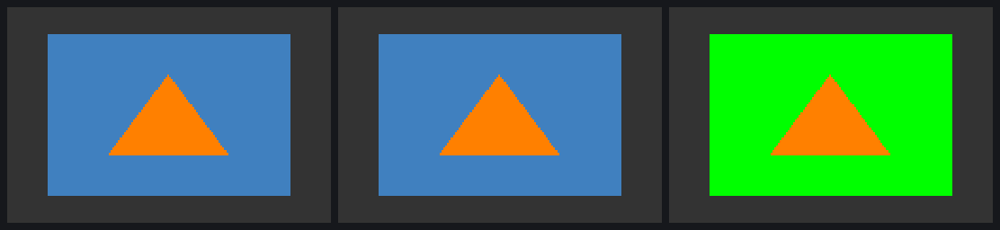
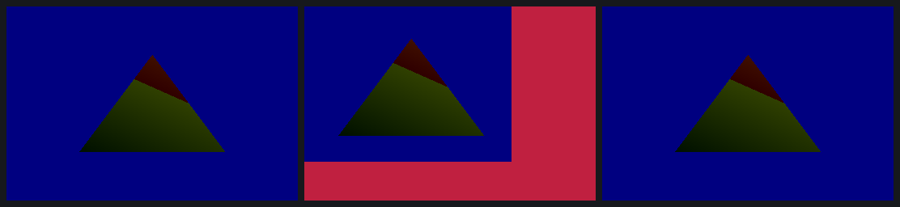
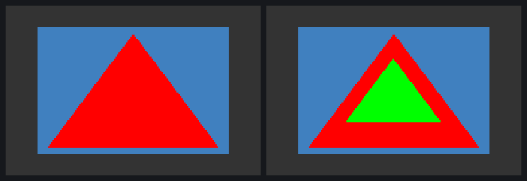

# Render to texture, putting frames on the display, and depth between renders

With textures understood, three things stood between the replayer and a real
GL application: rendering into a texture and sampling it, getting the frame
onto the screen without the DDK's EGL, and keeping a depth buffer across
renders.

## Render to texture

A probe FBO capture is five TA kicks on one render context, with two render
targets (the FBO's and the window's), each with its own RT data, render
details and region headers. The FBO's end-of-tile program writes the texture
directly, **twiddled** (PBE sideband b13), with PBE format codes 1, 3, 4, 5
for RGBA8888, RGB565, RGBA5551, RGBA4444. The window then samples it like any
other texture.

The first native replay of it hung the GPU. All five TA kicks completed, but
no 3D render ever started. The cause: the per-render **HW sync list** in
kernel data holds absolute op counts that the *client* writes. The DDK had
submitted one transfer for the FBO texture (its initial fill) that the
replay skipped, so the FBO render waited forever for that texture's write op 1.
The replay left the microkernel stuck, and the next client hung. Three power
cycles to find it, with a new `--peek` option printing the TA/3D status words
after every kick. With the transfer replayed too, the frame is exact.

Left: the DDK. Middle: our replay, where the FBO texture comes only from the
replay's own FBO render (byte-identical to the DDK's). Right: the FBO's clear
changed to green, 0 pixels off the prediction (170,094 pixels changed).

RGB565 (dithered) replays pixel-exact too.

## Presentation

The DDK's EGL mmaps `/dev/fb0` and wraps that mapping as GPU memory.
`eglSwapBuffers` is one transfer-queue blit from the back buffer into it. The
replayer can now do all of it natively (`replay -F` wraps the real fb0). Each
image below is `/dev/fb0` read back with `head -c` after a run:

- left: the DDK's own swap transfer, replayed natively;
- middle: a blit whose every word came from `tools/tex/present.py`, a
  512×384 crop of the back buffer to the top-left over a red pre-fill;
- right: no blit at all; the frame's own PBE address pointed at fb0.

All three are 0 pixels off (the DDK's frame, or the prediction).

PBE word 2's b15 is not a "scanout" bit as STATE.md had guessed: with it
cleared the PBE writes nothing at all.

## Depth across renders: a DDK bug, half fixed

The probe draws a green triangle into an FBO with a depth buffer, samples it,
then draws a red triangle *behind* it into the same FBO without clearing.
The GL-correct result keeps the green triangle on top (right). The DDK's
frame (left) has no green pixel left: libGLESv2 only sets up depth load/store
(ZLS) for window surfaces, so an FBO's depth is gone after any render.

Replaying the frame with the window path's ZLS bits on the FBO's render
(`0x0017101c`) makes the GPU store the depth (as float32). The matching
*load* was not found. Two candidate bits (b0, b1) hard-lock the 3D, and one
of those lockups needed a power cycle. The rest of the bit sweep is in
`docs/TEX.md` section 7.

## Numbers

- 13 runs in `data/2026-10-28-0936-render-targets-present.csv`; every claim
  except the depth load is 0 pixels off.
- Power cycles on the EA3 caused by this work: 4 (three while finding the FBO
  sync-list hang, one for a ZLS bit), each followed by srvinit and a
  pixel-exact control replay.
- Also learned: the "wait until card0 is free" loops of the sessions sharing
  the EA3 raced, which shifted 9 captures' addresses. Captures and replays now
  take `flock /tmp/gpu.lock` and are rejected and retaken if shifted.

Commits on `um-re` after the restructure: `da88290`, `adddd09`, and this
entry's commit.
