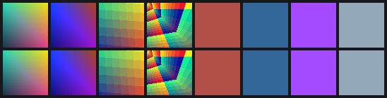
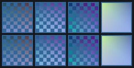
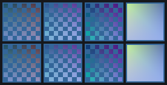

# A shader compiler: NIR in, USSE out, running under the DDK's own driver

By 07:00 the USSE instruction set was decoded and checked, but nothing generated code
for it except libusc. This session wrote that generator: `usc/` on `um-re`. It takes
GLSL ES 1.00 through Mesa's GLSL frontend to NIR, and lowers NIR to USSE instructions
inside the DDK's USP container. On the EA3 the result is checked pixel for pixel against
libusc's code for the same program. The DDK's own GLES driver runs both.

## The pieces (commits 4fc4ef2..4ea34ba)

- **An encoder generated from the ISA tables.** `tools/usc/gen_forms.py` turns `tools/isa/hw.py`
  (172 forms) into C tables. `usse.c` is `hw.encode()` ported over them. On all 4154
  corpus words the C encoder gives the same 64 bits as `hw.py`. So there is one
  description of the encoding, not two.
- **Mesa, standalone, on the Mac.** Mesa 27.0.0-devel builds its GLSL compiler on macOS
  in 52 s with only softpipe enabled. `sgxc` links each stage as a separable program.
  The DDK compiles every shader on its own, so Mesa's cross-stage varying packing must
  not happen: it had turned `t.xyw` into a three-component varying.
- **The backend** (`sgx_compile.c`). A NIR vector op becomes one instruction with a
  repeat wherever the operands allow it. The float 3-source class steps or holds each
  source by its increment bits; scalars, moves and selects step everything. Registers
  are runs of temporaries allocated with Mesa's `util/ra` contiguous classes.
  `nir_legacy` carries the source modifiers and register writes. `sin`/`cos` reduce
  the argument to [-2, 2) quarter turns for the hardware's `fsin`. Textures become USP
  sample blocks: non-dependent (the PDS iterates and samples, including the projected
  x/w case) or dependent with an `smp` template. A `discard` is the keep predicate p1
  plus the feedback `nop` between labels 4 and 5. Loops and branches become label and
  branch blocks.
- **mediump in F16** (`sgxc -p`, from Mesa's precision lowering). It works the way the
  DDK does it: varyings iterated as F16 and arithmetic in `fmad16` lane pairs. Mediump
  uniforms are F16 pairs and lowp vectors C10, converted with `pck.f16.c10`. Texels come
  in through `pck.f16.u8`. `mix` is computed in libusc's order, `(b·t + a) − a·t`, and
  floor as `fsubflr` plus `fmad16`.

## Is the code what libusc would encode?

`usc/check_out.py` takes every word sgxc emits through three checks. It must decode with
no unexplained bit, and its text must assemble back to the same bits. Then the USEASM
instruction its fields describe is run through libusc's own encoder (`oracle.py`). The c1
corpus gives 649/649 words identical to libusc's. The gl4es fragment shaders in F16 give
75/75.

## Same pixels? Running our USP inside the DDK's driver

The comparison needs the rest of the driver unchanged: PDS, state, finalizer. So
`usc/hw/uspsub.so` hooks `PVRUniFlexCompileToUspBin` and writes our USP into libusc's
own result buffer. `glt` draws each test program into a 64×64 RGBA8 pbuffer, once with
libusc's USP and once with ours. Two things had to match the DDK's GLSL compiler, which
numbers these outside the USP:

- **Constant numbers.** The DDK numbers constants in order of first appearance, literals
  included. `step(u, v)` puts v first, and `1.0 / u` puts the literal first.
  `usc/hw/calib.py` measures them on the GPU: a probe USP outputs constants k..k+3 while
  every uniform holds a marker value. It runs twice, with markers 100 apart, so a
  literal can't be mistaken for a uniform.
- **Sampler numbers.** These are the samplers used, in order of use. A wrong one, read
  from Mesa's uniform location, made the TA read an unbound texture unit. That caused
  the session's two SGX recoveries; both recovered on their own.

| test set | identical frames | the rest |
|---|---|---|
| c1, the one-op corpus (105 programs), all F32 | 95 | 10 mediump/lowp variants: the DDK computes them in F16/C10; 9 differ by 1 LSB, `mod_l` by 126 (floor of a C10 quotient) |
| c1, mediump/lowp variants in F16 (`-p`) | **96** | the 9 lowp variants (`_l`): the DDK computes lowp in C10 fixed point, we in F16; 8 differ by 1 LSB, `mod_l` by 127 |
| gl4es Minecraft 1.7.10, vertex shaders (4) | **4** | |
| gl4es Minecraft 1.7.10, fragment shaders in F32 (4) | 0 | every difference ≤ 1 LSB; discard (alpha test) pattern identical |
| gl4es Minecraft 1.7.10, fragment shaders in F16 (4) | **4** | also 4/4 with both stages ours |

The gl4es shaders are exactly what gl4es generates. `tests/gl4es/fpegen.c` runs gl4es's
`fpe_VertexShader`, `fpe_FragmentShader` and `ConvertShader` for the game's states
(terrain with lightmap, items, GUI, sky), with `LIBGL_VERTEXFOG=1` as on the box. They
are drawn with a cut-out texture, a lightmap with its texture matrix, vertex colours and
linear fog over a tilted quad. The F16 fragment shaders, which reproduce libusc's
mediump code, were ready and encoder-checked when the EA3 became unavailable; their
pixel run is the next entry.

## Instruction counts (per pixel; `usc/count.py`, data/usc-counts-c1.txt)

| | sgxc | libusc main | libusc secondary (per draw) |
|---|---|---|---|
| c1, 105 programs | 646 | 157 | 872 |
| gl4es fragment shaders (F16) | 75 | 43 (+ finalizer unpack) | 18 |

libusc moves uniform-only math into the secondary update program, which runs once per
draw. sgxc doesn't yet, so on c1, where almost everything is uniform, it does that work
per pixel. That hoisting, plus fewer F16 repacks, are the next optimisations.

The F16 runs were taken under the shared `flock /tmp/gpu.lock` that the EA3's users
agreed on. Data: `data/usc-hw-c1.txt`, `usc-hw-c1-f16.txt`, `usc-hw-gl4es-*.txt`.

## Open

- lowp: the DDK computes it in C10 fixed point (colour-class ops), we in F16.
- Divergent branches: loops and ifs are emitted as predicated `br`. They have only run
  where the condition is uniform. libusc branches only around texture reads.
- Not done yet: dynamically indexed uniforms (`varr`), vertex texture fetch, `fddx`/`fddy`,
  spilling, the secondary-program hoist, and the glslcompiler attribute order (taken from
  first use in the source; right for the gl4es shaders).
