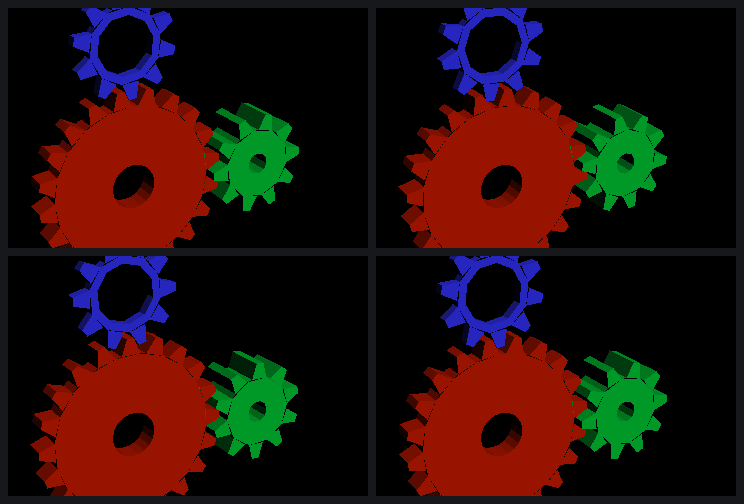

# The Mesa driver: EGL, GLES2 and es2gears on our own stack

By this morning the parts of an open userspace existed, but no program could
use them: a frame generator (`tools/gen`), a services client (`libpvr`), a
NIR → USSE compiler (`mesa/src/sgx545/compiler`). This entry is the gallium
driver that turns them into EGL and GLES2 (`mesa/`, see `mesa/README.md`),
and the three milestones it reached on the EA3 on the 28th:

| milestone | result | commit |
|---|---|---|
| (a) the screen initialises, `eglinfo` lists the driver | `GL_RENDERER: PowerVR SGX545 (sgx545-ce)`, `OpenGL ES 2.0 Mesa 26.2.5`, 6 configs (window + pbuffer, depth 24/stencil 8) | `d4875ea` |
| (b) clear + triangle through GLES2, pixel-exact against the DDK | `tools/probe`'s reference scene: `glReadPixels` byte-identical to the DDK's probe-st, md5 `232e4930…` | `d4875ea` |
| (c) es2gears animating on fb0 | es2gears' own shaders compiled by our compiler, transform and lighting on the GPU, depth and back-face culling: 403 FPS at 720×480 | `8c72fcc` |

## What the stack is

- **Mesa 26.2.5**, pinned by sha256 in `mesa/VERSION`. `mesa/build.sh`
  fetches it, applies two small patches (the meson, loader, pipe-loader and
  EGL hooks), copies the `mesa/src` overlay in, and builds with zig cc for
  x86_64 and i386 against glibc 2.36. That ABI runs on openHC's Buildroot
  userspace (glibc 2.42) and on the Debian bookworm root of the Minecraft
  runtime. `libgallium` is 19 MB; nothing is built on the boxes.
- **The loader** picks `sgx545` for PCI `8086:*` when the kernel driver is
  `pvrsrvkm`, the way it picks iris.
- **EGL's new `fbdev` platform** treats a window as the framebuffer console, as
  the DDK's LinuxFB WSEGL does. Any native window handle is accepted,
  including NULL, which is what gl4es passes. The window's colour buffer is
  fb0 itself: `resource_from_user_memory` wraps the mapping as device memory,
  the PBE renders into the scanout buffer, and `eglSwapBuffers` waits for the
  render. Pbuffers are as on the surfaceless platform. EGL's device list
  only takes DRM devices with a render node, and pvrsrvkm has only `card0`,
  so the platform enumerates primary nodes itself.
- **The gallium driver** (`mesa/src/gallium/drivers/sgx545`): screen,
  context, state objects, resources, draw, clear, flush.
  - Buffers live in CPU memory. Render targets are device memory with a
    32-pixel pitch.
  - A draw gathers its vertices on the CPU: indices are resolved, and every
    attribute is turned into the four dwords the vertex program fetches. They
    go into the frame's ring.
  - Constants are laid out into secondary attributes the way the USP's list
    C says.
- **The winsys** (`mesa/src/gallium/winsys/sgx545/drm`) is `tools/gen`'s
  sgxgen as library code (`sgx545_frame.c`) over `libpvr`. The colour buffer
  is now the caller's, and a frame can be followed by any number of others.

## Frames forever in one context

sgxgen had only ever drawn one frame per process. The EA3 could run three in
one context; the fourth locked up the 3D, deterministically. Each lockup cost
a power cycle.

Three steps found the cause:

1. **The DDK's own frames.** `tools/probe` grew `PROBE_FRAMES=n`. A 3-frame
   and a 6-frame capture of probe-st showed the DDK's protocol:
   - one kick per frame, first and last in scene;
   - TA flags 0x63, plus 0x10 on the render target's first frame;
   - the frame number at command +0x20 and at b14 of the 3D flags
     (`0x400 | f<<14`);
   - the RT data entry and the region headers alternate.
2. **A word-by-word diff.** Our kernel-data and sync allocations land at the
   DDK's own addresses, so every word could be compared address by address
   with our own trace (`SGX545_TRACE`) at each kick. Three client writes
   per frame were missing:
   - the RT data header's frame counter (`frame + 1`; the entry that renders
     is `counter & 1`);
   - render details +0xdc, which names that frame's RT data entry;
   - the render-details sync word and the HW sync-list access word, back to
     1 (the microkernel clears both).
3. **The symptom.** Left alone, the counter stays at 1. Odd frames retire
   the wrong entry, their PB pages are never freed (pages in use 0x19,
   0x19, 0x32), and the fourth render hangs.

With the three writes, 300 frames run in one context at 2.7 ms each. That
crosses the CCB's wrap three times. PB pages in use stay at 0x19, as the
DDK's do, and the last frame is the reference, md5 `56f8466a…` (`c0031b3`).

## Compiled shaders, finalised in the driver

The compiler hands back a USP, as libusc did, and the driver does what the
DDK's GL driver did with it. Four hardware facts came out of making that
work:

- **The fragment colour's last `mov` needs a write mask.** The compiled
  program packs BGRA8 into pa0; the driver appends `mov o0, pa0 [end]`. Without
  `mask=1` that mov hangs the GPU, although the pixels come out right: the
  probe scene was md5-identical to the DDK and still tripped the lockup
  timer. With `mask=1`, as in the DDK's own `mov o0, sa9`, it renders in
  0.5 ms.
- **Iterator kinds 0xb-0xf in list A are not varyings.** The compiler puts
  a colour iteration (kind 0xb) in a shader without varyings. Iterating a set
  the vertex program doesn't output locks the GPU, and so does the colour
  source 0x20, because our vertex programs output no colour. The driver
  drops those iterations, and the shader writes pa0 itself.
- **Secondary DMAs of more than 16 dwords.** es2gears' 39 vertex constants
  made a single 49-dword DOUTD. It drew garbage geometry: the constants past
  the start never arrived. A DDK capture of a shader with a uniform array
  (`uniform vec4 m[12]`) explained it:
  - the DDK never DMAs more than 25 dwords at once;
  - its "kind" field b22-23 is `(dwords - 1) & 3` in every case seen (10, 11,
    12 and 25 dwords give 1, 2, 3, 0).

  The winsys now splits secondary DMAs into 16-dword DOUTDs, each with that
  field. es2gears' geometry came out right.
- **MTE cull.** The sense was inverted. Cull back, cull front, and cull back
  with a CW front face are now byte-identical to the DDK.

A vertex program is wrapped the DDK's way:

1. phase 0 is the DDK's prologue;
2. phase 1 is the shader, then `emit.t3`;
3. then the epilogue phase.

A fragment program is `phas`, the shader, and the masked mov. Its constants
are DMA'd into sa9 on, and a task that runs to the DMA's `wdf` follows. The
empty task there also hangs the GPU.

## Also found

- **Kernel bug.** `OSAcquirePhysPageAddr` (`kernel/src` osfunc.c) keeps the
  wrapped user address in 32 bits, which dmesg shows as "Start address
  9f7d7000 is outside of the region returned by find_vma". So
  `WRAP_EXT_MEMORY` of a 64-bit process's fb0 mapping fails. The fbdev
  platform maps fb0 with `MAP_32BIT` until the driver is fixed. This is the
  same family as the `DoMapToUser` bug in NOTES.md.
- **Cleanup on srvinit boots.** When srvinit starts the microkernel, every
  render-context cleanup at process exit times out ("Wait for uKernel to clean
  up (2)"), for DDK clients too. It was not seen on a blob-initialised boot.
- **Power cycles.** This work cost four Bench cycles (09:12, 09:33, 09:50,
  09:53 UTC), all multi-frame 3D lockups. The last two ran a stale test
  binary: the deploy script copied an old build over the new one.

## Numbers

`data/2026-10-28-1020-mesa-driver.json`. 720×480, x86_64 build, srvinit-started
EA3.
