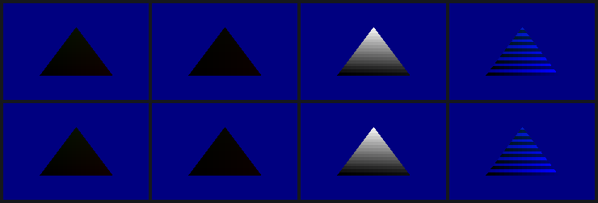
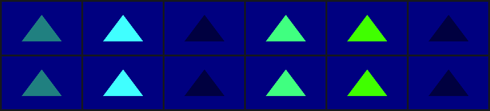
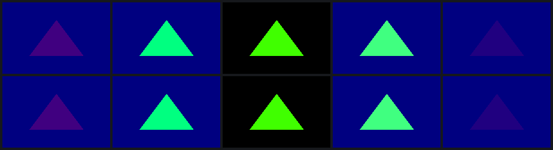

# The Mesa driver samples textures, blends, and masks colour

The driver of the previous entry drew untextured, opaque geometry. gl4es and
Minecraft need three more things before anything of theirs can draw:
textures, blending and colour masks. All three are now on the EA3, each
checked against the DDK drawing the same scene with `glReadPixels`:

| feature | cases | against the DDK | commit |
|---|---|---|---|
| textures | 16×16 nearest and linear, 64×64, 12×6 NPOT with clamp, L8, LA88, RGB565 | 7 of 7 byte-identical | `5204d75` |
| blending | every ES 2.0 factor except the constant ones; ADD, SUBTRACT, REVERSE_SUBTRACT | 10 of 10 byte-identical | `23ea4c1` |
| MIN, MAX (EXT_blend_minmax) | 2 | GL-correct; the DDK rejects them (INVALID_ENUM) | `23ea4c1` |
| colour masks | R, B, G or A off, all off, and two under a blend | 7 of 7 byte-identical | `353102e` |

The i386 build (`mesa/build.sh i386`, for the Minecraft runtime's Debian
bookworm userspace) runs too. The DDK's own i386 probe-st, with our
libraries swapped in, draws its reference scene byte-identical to the DDK
through the kernel's 32-bit compat path.







## Textures

- **Device copies.** A texture keeps a linear CPU copy for transfers and a
  copy in the texture heap that the TPU reads. The device copy is rewritten
  when a transfer that wrote is unmapped. Its layout follows `docs/TEX.md`:
  - power-of-two sizes are twiddled, in 16×16 tiles, Morton order with y in
    the lowest bit;
  - other sizes are linear, with the pitch aligned to 8 pixels;
  - each mip level follows the previous one.
- **The sampler words** are DOUTT's T0-T3: wrap modes and filters, then
  format, layout and size, then the address. For RGBA8, our compiler's unpack
  reads xyzw, so the driver tags it with format 0x0c (R/B came out swapped
  with the DDK's code).
- **The iteration.** The USP's list A names each sample's coordinate set.
  - A sample of the set the previous DOUTI iterates is merged into that
    DOUTI, as the DDK's generator merges it.
  - A separate sample samples at coordinate 0.
  - DOUTU's second word needs b24 whenever a DOUTI iterates, and b25 when one
    samples. Without b24 the merged DOUTI locked up the 3D.
- **Varying names.** Mesa's linker packs varyings (`packed:v`, comma lists).
  The driver parses those names as the compiler does, so both stages agree
  on each set.

## Blending and colour masks are a few more instructions

The SGX545 has no blender (`docs/STATE.md`). The DDK appends code to the
fragment shader, and sets the ISPA pass type to translucent so that o0
starts as the tile's colour. A capture of probe-st with
SRC_ALPHA/ONE_MINUS_SRC_ALPHA differs from the opaque one in exactly two
places:

- ISPA b25 (pass type 1);
- the program's last instruction.

The opaque program ends with `mov o0, sa9`. The blended one ends with:

```
mov  pa0, sa9                [skipinv mask=1]
sop2 o0, pa0, o0             [skipinv end c1=s1a c2=1-s1a cop=add a1=s1a a2=1-s1a aop=add]
```

sop2's colour and alpha halves each take a selector per source: zero, s1,
s2, s1a, s2a, asat, plus a complement bit. That covers every GL factor except
the constant colour, two selectors (k18/k19) not decoded yet. The driver:

1. maps each factor to a selector, with s1 as the shader's colour and s2 as
   the tile's;
2. maps DST_ALPHA to one when the colour buffer has no alpha;
3. builds the sop2 for the blend state;
4. uploads one program per shader and blend state, on first use.

REVERSE_SUBTRACT trades the sources (`sop2 o0, o0, pa<c>`) and renames the
selectors. An encoder in C writes the words, and every one of the 83,072
selector, op, source-order and mask combinations it can produce matches
`tools/isa`'s assembler.

A colour mask is ISPB's mask plus one more instruction,
`sopwm o0, pa0, pa0 [end mask=m]`, with a bit per byte of the packed BGRA8.
The first try set only ISPB, and every masked channel was written anyway.
Under a blend, the DDK's sop2 writes `r0` without `end`, and the sopwm still
reads pa0. Ours writes the blend back to pa<c>, and the pixels match.

## Numbers

`data/2026-10-28-1100-mesa-textures-blend.json`. 720×480, x86_64 build,
srvinit-started EA3. A/B scripts: `mesa/tests/sgx545_texab.sh`,
`mesa/tests/sgx545_blendab.sh`. No SGX recoveries and no power cycles in this
work. The reference scene is still md5 `232e4930…`, and es2gears still runs
at about 420 FPS.
