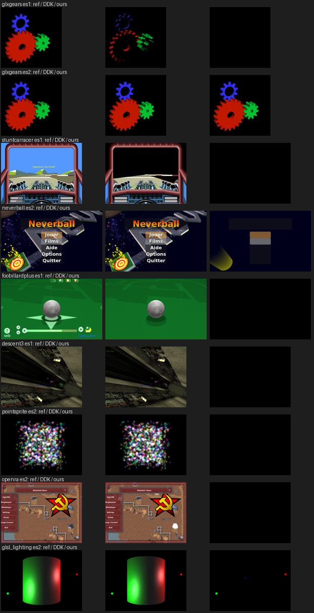
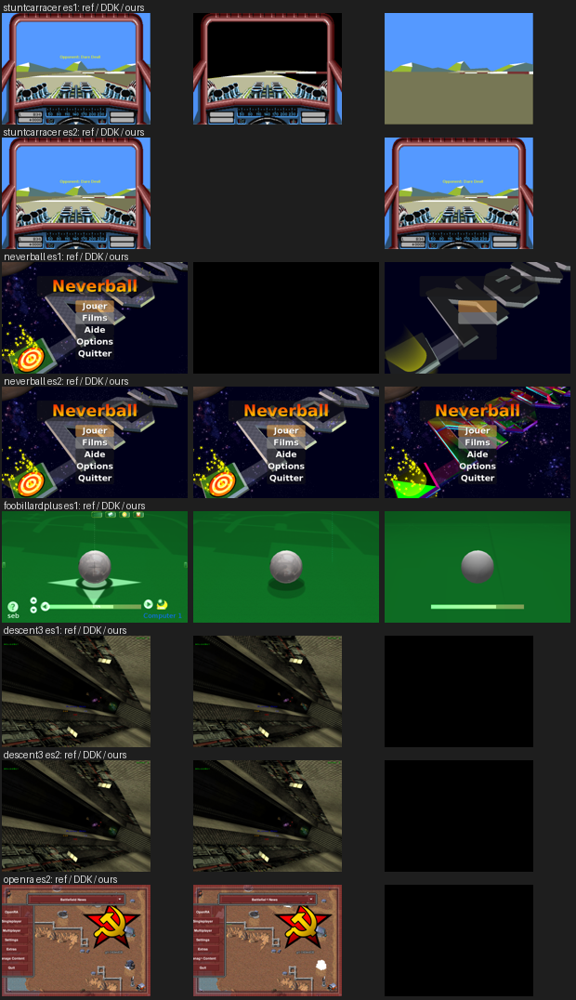
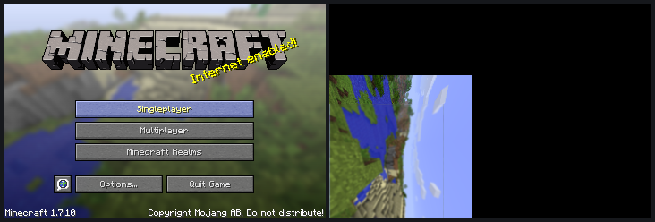

# gl4es' ctest traces on our driver, against the DDK

Milestone (d) is the gl4es ctest suite, run on the EA3 with the DDK and with
ours. gl4es' `tests/` holds apitrace traces of six programs (glxgears,
stuntcarracer, neverball, foobillardplus, descent3, pointsprite on GLES 1 and
2; openra and glsl_lighting on GLES 2 only) and a reference image of one call
in each. The rig replays every trace through the openhc-minecraft runtime's
gl4es on both stacks. It compares the two snapshots pixel for pixel, and each
with gl4es' reference the way gl4es' own `test.sh` does (`mesa/README.md`,
"The gl4es ctest suite on the EA3").

| | first run (`bd3f641`) | today (`fae9f54`) |
|---|---|---|
| replays that finish | 14 of 14 | 14 of 14 |
| SGX recoveries, ours | 1 in 14 replays | **0** in 14 |
| SGX recoveries, the DDK | 6 replays with recoveries (glxgears ES1 6, descent3 ES1 3, ...) | (DDK not re-run) |
| ctest passes, the DDK | 5 of 14 | 5 of 14 |
| ctest passes, ours | 1 of 14 (glxgears ES2) | 1 of 14; ours is now closer to the reference than the DDK on glxgears ES1 (408 against 19,817 px off), neverball ES1, foobillardplus ES1 and ES2 |

On glxgears ES2, ours and the DDK differ on 1753 pixels, by at most 1.
That is F32 against the DDK's F16 iteration of mediump varyings.

## What the traces found

Each item below locked the GPU up on the EA3. On this box, one lockup
usually leaves the microkernel failing to re-initialise ("SGXInitialise
failed (24)"), so each one cost a power cycle.

1. **A second render context in one process.** Mesa creates two pipe
   contexts under glretrace, and gl4es initialises EGL twice. Each pipe
   context had its own render context and parameter buffer. The renders then
   took 100-900 ms in a period-4 pattern, the PB stayed at 0 pages, and the 3D
   locked up after ~250 frames. The screen now owns one render context and
   keeps it, with the services connection, across `eglTerminate`, as the DDK
   keeps one parameter buffer per process. glxgears went from 150 s to 20 s
   (the DDK takes 37 s).
2. **Discard.** gl4es' clip planes discard. Drawn in an opaque pass, the first
   discarded pixel locks the GPU up. Such shaders are refused until the
   feedback split exists (ISA.md "Phases, visibility feedback and discard";
   the compiler already emits its half).
3. **The PDS middle word.** It was a constant that only fitted a program with
   up to 4 primary attribute dwords. The DDK's captures with 0-5 vec4
   varyings show it: b0-15 = attribute units of 4 dwords, b25-28 = 12 / units.
   Two F32 vec4 varyings (any textured fixed-function shader: colour plus
   coordinates) overflowed and locked the GPU up.
4. **Vertices per USSE task** were 64 / output dwords; the DDK's are 128 /
   output dwords, at most 16 (4 to 24 output dwords measured; the inputs don't
   count).
5. **Dependent texture samples** (gl4es' `texture2DProj` with a vec3) were
   refused. The driver now puts the USP's `smp` template into the program,
   with the sampler's DOUTT words in SA, and a `wdf` after it. Swizzled,
   projected and biased dependent samples are byte-identical to the DDK.

On the way, more traps cost five Bench cycles:

- **One GPU, one init.** The EA3 image doesn't bring the GPU up at boot.
  After a cycle it was brought up with the open srvinit, and on that GPU a
  process's render-context cleanup never completes, so the next client reads
  the dead one's structures. The rig uses the DDK's `sgxinit`.
- **The DDK can't re-initialise EGL** in a process. After `eglTerminate` its
  `SGXAddRenderTarget` dereferences NULL, so the DDK only replays with gl4es'
  hardware probe off (`LIBGL_NOTEST=1`, for both stacks). The DDK also locks
  up by itself on several ES1 traces.
- **Finding a hang without the GPU.** `SGX545_DRY_RUN` builds and traces
  every frame without kicking, and `tools/state/decode.py` reads the trace.
  `gpuwatch.sh` kills a client at its first recovery.

## Discard, then the suite again (`5bd4fe8`)

Discard is now drawn the DDK's way: two phases, `pcoeff` of a depth plane the
PDS iterates, `atst8` in place of the feedback `nop`, pass type 4 (2 with a
blend), and two control words in sa3/sa4 (`0xe000 | depth compare | 8
without depth writes`, `0xee00`). Four discard cases are byte-identical to
the DDK (`mesa/tests/sgx545_discardab.sh`). With it, 14 of 14 traces still
replay with no SGX recovery. stuntcarracer ES2 passes ctest (1 pixel off the
reference; the DDK crashes on that trace), and neverball's logo appears.

## Minecraft, first light

`mesa/tests/mc-ab.sh` runs the game (the openhc-minecraft runtime, gl4es as
shipped) on either stack, through `gl4es-run-sgx545` for ours. Two things
first:

- On this EA3 the DDK cannot start the game as `gl4es-run` does: gl4es'
  hardware probe re-initialises EGL, and the DDK then crashes in
  `SGXAddRenderTarget`, the same crash as under glretrace (the EA1 runs the
  game, so something about this box differs). With `LIBGL_NOTEST=1` both
  stacks start it, at about 1 FPS on the title screen (gl4es without its
  probe).
- Ours draws the title screen's panorama but not the frame built from it
  (the panorama copied into a texture, blurred, with the logo and buttons
  over it). That is the next thing to find.

## What is left for ctest

- **Alpha test on ES1** (the ES1 cockpit and logo) and descent3 (black on
  both GLES versions), not looked at yet.
- **gl_FragCoord / gl_PointCoord** inputs (openra, pointsprite) and a
  saturated dot product (glsl_lighting). These are compiler gaps and have
  been reported to the compiler session.
- stuntcarracer replays in 214 s against the DDK's 32 s; not looked at yet.

## Numbers

`data/2026-10-28-1530-gl4es-ctest.json`: the per-test comparisons of both
runs.
