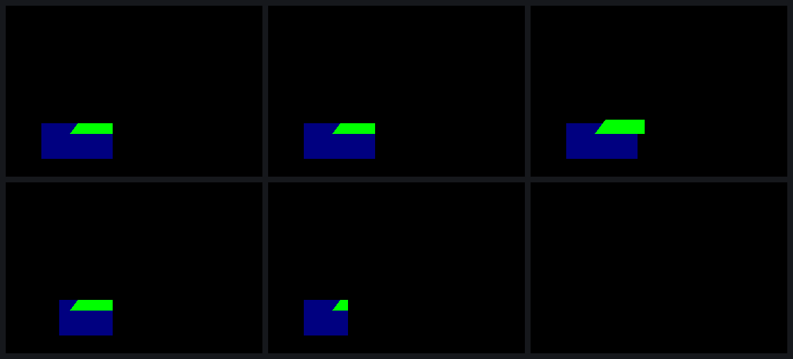

# Scissor: a visible bit per pixel, written by objects

The Mesa driver could draw everything Minecraft's title screen needs except
what lies outside a rectangle: gallium hands it a scissor and partial
viewports, and the SGX545 has no scissor register. STATE.md had noted that
libGLESv2 inserts "pass type 3" objects for a scissor, but not what they do
or how to make them.

## What the DDK does

Eight one-change captures of `probe-st3` (scissors aligned and not, two
scissors in one render, a zero scissor, one covering the target, no clear,
partial viewports) all show the same machinery:

- The ISP keeps one **visible bit per pixel**. Pass-type-3 objects draw no
  colour and run no pixel program; they only write that bit: a **reset**
  object (ISPC b25 = 0) under a full-target triangle, then a **set** object
  (ISPC b25 = 1) under a strip over the rectangle.
- Every later object is drawn only where the bit is set, whatever its own
  geometry.
- The TA's **region clip** (state group 0x80, in 32×16 tiles) is sticky:
  draws don't carry one, so they keep the set object's.
- A render that doesn't start with a full clear begins with a **load
  object** that samples the colour buffer, scissor or not; with a scissor,
  that is what keeps the pixels outside.

## The proof

The native replayer replayed the `glScissor(100, 50, 200, 100)` capture
with one word changed per run. Each frame was compared with a prediction
computed from the DDK's own readbacks:

| run | change | prediction | pixels off |
|---|---|---|---|
| q0 | none | the DDK's frame | 0 |
| q1 | reset becomes set | everything visible, cut to the clear's tiles | 0 |
| q2 | the strip's left edge 100 → 150 | the scissor starts at x = 150 | 0 |
| q3 | the set object's region clip 3..9 → 3..6 | nothing right of x = 224 | 0 |
| q4 | set becomes reset | nothing visible | 0 |

q1 is the run that showed the region clip is sticky. With the whole target
visible, the triangle still stopped at the edges of the tiles of the clear
drawn before it.

Top row: the DDK's frame, q0, q1. Bottom row: q2, q3, q4 (black).

## For the driver

`tools/state/sgxstate.h` builds both objects. `sgxs_scissor_objects`
returns their TA blocks, vertices and primitives for a rectangle, and the
blocks carry the region clips; the vertex program they run is
`sgxs_vpgen_vs`. `sgxstate_test.c` checks them against the words of the
sc1, sc2, sc5 and sc6 captures. The details are in `docs/STATE.md`,
"Scissor and partial viewports".

Data: `data/2026-10-28-1640-scissor.csv`. No SGX recovery in any run.
