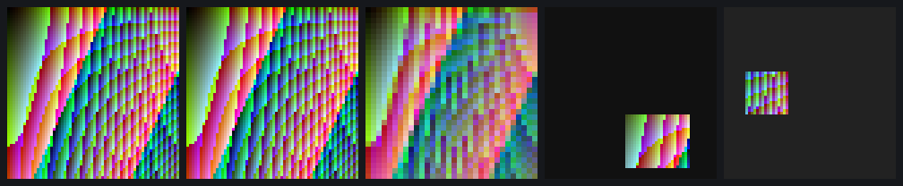
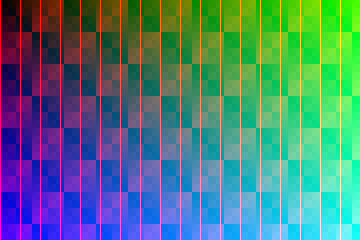

# GPU blits on a transfer context of our own, sub-rectangles, and the swap to fb0

The Mesa driver runs Minecraft now, but it did texture copies and mipmaps on
the CPU, and it rendered straight into the scanout buffer. The DDK does
those on the GPU with its transfer queue, and so far we had only replayed
the DDK's own transfers.

## Our own transfer context

libsrv_um's `SGXCreateTransferContext`, decompiled, gave the buffers a
context needs and the six words of its 0xb4-byte registration (the rest the
DDK leaves uninitialised). With that, every word a context and a blit need
comes from `tools/tex/sgxtex`. That covers the static PDS and USSE programs
and the per-blit command, background block, pixel program and end-of-tile
program. Before touching the GPU, they were checked against the 364 words
the DDK wrote for its two contexts in an old capture: all match.

`tools/tex/blitest` then runs blits with no DDK and no capture. The first two
attempts failed on the client side, not the GPU:
- a NULL sync handle: the surfaces had been allocated with the
  no-sync-object flag;
- a crash on mapping a sync object a second time.

After that, every case is byte-exact against its prediction
(`data/2026-10-28-1651-gpu-blits.csv`):
- upload and readback;
- scaled copies;
- NPOT sources;
- RGB565 conversion (truncation);
- mip levels. NEAREST gives the DDK's texel (2x+1, 2y+1); LINEAR gives a
  real box filter, a two-step rounded average.

## Sub-rectangles

A sweep of the background block's words on the EA3 showed that words 3-8 are
the texture coordinates at the background triangle's three vertices. Set
them, clip the PBE and the tiles, and a rectangle copies exactly. One more
surprise: for a *twiddled* destination the PBE takes the tile row length
from the clip width, so a narrow clip writes the right pixels to the wrong
places. Full-width bands are fine, and anything else takes three blits
(readback, sub-copy, upload). All exact.

Left to right: the source, the readback, the box-filtered 32×32 mip level,
a 24×20 sub-copy into a cleared surface, and a 16×16 sub-copy into a
twiddled texture in three blits.

## Presenting

The same context blits a 720×480 back buffer into the real `/dev/fb0`
(wrapped as the DDK's EGL does) in 1.3 ms. fb0 read back is the back buffer,
pixel for pixel:

Render-to-texture targets need no conversion: the DDK renders power-of-two
ones twiddled and others linear at an 8-texel pitch, and samples them in
place. `sgxtex_rt_*` reproduces its words for both.

## What didn't work

**Vsync.** fb0 is `simplefb` with no pan or flip. The display controller has
an i9xx-style pipe whose status register looks like it carries a vblank bit.
But a read-only scan of its whole MMIO window hung the EA3 (power cycle).
A few minutes after the next boot the whole block started reading 0, cause
unknown; the picture stayed up, so only register access went away. Vsync is not established, so the 1.3 ms swap blit is the tear-light
path for now.

Commits: `2101ae9`, `34ebaac` and this entry's commit on `um-re`.
