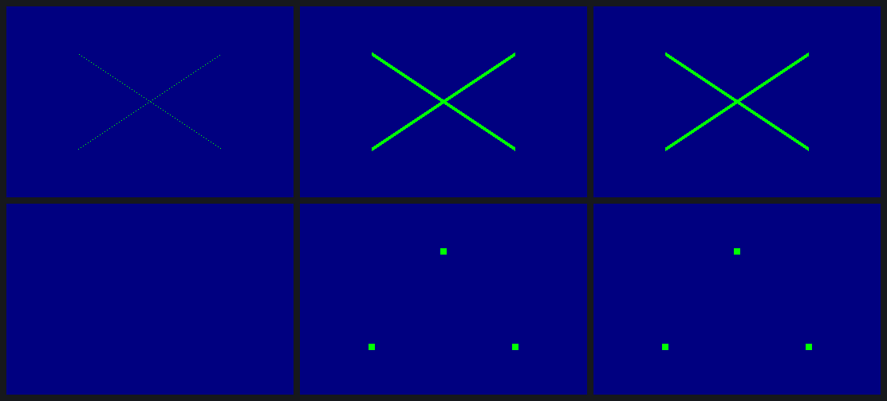
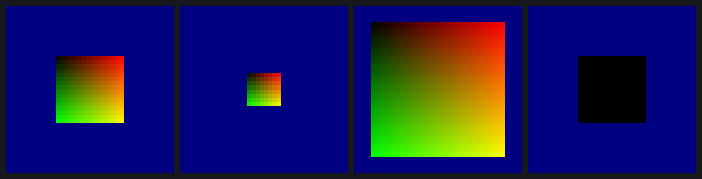

# Lines and points: an object type, a width, and a size the vertex writes

Gallium hands the driver every primitive GL has. Until now the Mesa driver
drew triangles only, so gl4es' line and point traces and Minecraft's
selection box came out empty.

## What the DDK does

From twelve one-change captures:

- The **VDM** knows four primitives: triangles, lines, points and
  triangle strips, plus a fan bit. **There is no line strip.** The DDK's
  GL_LINE_STRIP is a line list that runs past the end of the strip's
  vertices: it is the stray-lines bug gl4es had to work around. Its
  GL_LINE_LOOP is a correct list.
- The ISP needs the **object type** in ISPA as well: 1 for lines, 3 for
  points, 4 for point sprites.
- **Line width** is ISPB in 1/16 pixel.
- **Point size** is not state at all. The vertex program writes it, as an F16
  in one more output dword. A point draw always carries a two-component
  texcoord set that the program doesn't write: in a sprite, the hardware
  fills it with gl_PointCoord.

## The proof

Ten replays of the DDK captures, one word changed each:

| run | change | result |
|---|---|---|
| l1, l2 | ISPB width 4 → 1, 1 → 9.5 | the DDK's own width-1 and width-9.5 frames, 0 pixels off |
| l3, l4 | object type 0 with a line list | nothing drawn: the type is required |
| p1 | the point-size output 8 → 16 | the DDK's own 16-px frame, 0 off |
| p2, p3 | a sprite's size 16 → 8, → 32 | the predicted gl_PointCoord gradient, (i + 0.5)/size from the top left, 0 off |
| p4 | sprite object type 4 → 3 | the same squares with the coordinate stuck at 0 |

Rows: the DDK's width-1 lines, l2 (width 9.5 from a width-1 capture), the
DDK's width 9.5; l3 (a strip retyped as lines, nothing drawn), the DDK's
16-px points, p1 (16 px from an 8-px capture).

One sprite, 6× enlarged: the DDK's 16 px, p2 (8 px), p3 (32 px), and p4
(object type 3: no coordinate).

## For the driver

`tools/state/sgxstate.h` provides the following, and `sgxstate_test.c`
checks them against the captures' words:

- `sgxs_prim` (GL mode → VDM bits + object type);
- `sgxs_ispa_objtype`;
- `sgxs_ispb_width`;
- `sgxs_point_size_word`;
- `sgxs_outsel`;
- `sgxs_line_list_indices` (strip/loop → list).

The compiler has to put gl_PointSize after the varyings and leave two
dwords for the coordinate. Details: `docs/STATE.md`, "Lines and points".

Data: `data/2026-10-28-1715-lines-points.csv`. No SGX recovery in any run.
