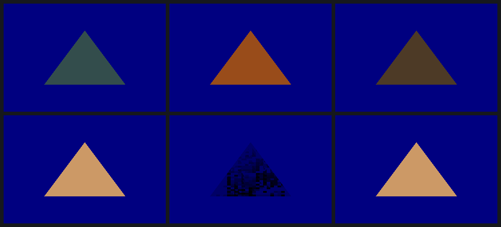

# Constant-colour blending: the DDK multiplies it out

The Mesa driver blends with one `sop2` after the fragment colour, its
selectors standing in for GL's factors. GL_CONSTANT_COLOR and friends had no
selector, and ISA.md listed two unexplained ones, k18 and k19, that looked
like the place a constant would go. Those draws fell back to opaque.

## What the DDK does

Eight captures with constant factors on the source side, the destination
side and both show one shape:

- Four `sopwm`s compute `r1 = dst × Fd` and `r0 = src × Fs`, an RGB pass
  then an alpha pass with a byte mask.
- One `sop2` adds them.
- The blend colour is just a fragment constant, packed BGRA8, in sa2.

`sgxs_blend_const` rebuilds the DDK's five instructions from libGLESv2's
own tables, with the registers as parameters, bit-exact for all seven
programs.

## The proof

Replays of `k1` (CONSTANT_COLOR, ZERO), one instruction word changed:

| run | change | prediction | pixels off |
|---|---|---|---|
| b0 | none | the DDK's frame | 0 |
| b2 | the source multiply's selector s2 → 1 − s2 | RGB of the DDK's ONE_MINUS_CONSTANT_COLOR frame | 0 |
| b3 | the same selector → s2a | the DDK's CONSTANT_ALPHA frame | 0 |

And k18/k19, tried in an ONE, ZERO blend's `sop2`:

- **k19** reads 0.
- **k18** reads state left over from earlier tasks: values that differ per
  4×4 block and step by the shader's own colour factor.

Neither is a constant register.

Top row: the DDK's CONSTANT_COLOR blend, b2, b3. Bottom row: the plain
ONE, ZERO blend, with k18 as c1 (blocks of leftovers), and with k18 as a1.

## For the driver

Use `sgxs_blend_const` for any blend with a constant factor:

- give it the colour's pa register and the sa register the blend colour is
  in (`sgxs_blend_color_word`);
- give the program two temporaries.

The DDK only ever adds the halves. The ops are parameters, but subtract with
constant factors is untested.

Data: `data/2026-10-28-1745-constant-blend.csv`. No SGX recovery in any run.
