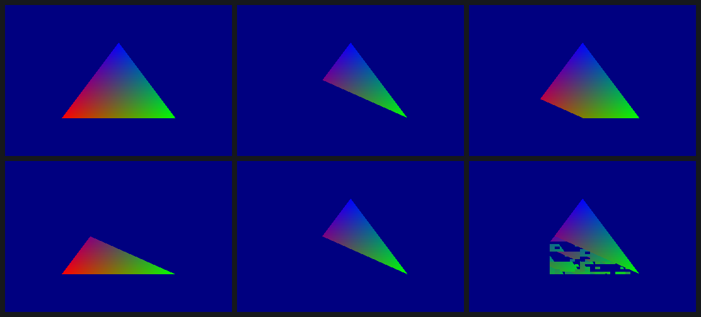

# ES1 alpha test: one instruction and two words

gl4es turns Minecraft's alpha-tested foliage and GUI into GL ES 1-style
alpha tests, and gallium gives the driver an alpha-test state. The Mesa
driver had discard working, through the DDK's two-phase `atst8` program,
but not the alpha test itself.

## A GLES1 probe

`tools/probe/probe1.c` is new: an ES1 frame (`libGLES_CM`) with
per-vertex colours whose alpha runs 0 → 0.5 → 1 across a triangle, plus
knobs for glAlphaFunc, blending, a texture, points and lines. Thirteen
captures.

## What the DDK does

Nothing in the TA state changes except the pass type, which goes from 0 to
1. The fragment program's final `mov o0, colour` becomes
`atst8 o0, p0.nw, colour, sa0, sa1 [end]`, and the secondary program
writes the two operands:

- **sa0**, the depth word: `0xe00f` with no depth test.
- **sa1**, the alpha word: the reference as a byte in bits 24-31 and the GL
  function in bits 13-15, e.g. GREATER 0.5 = `80008e00`.

These are the same two words the Mesa driver's discard program already
passes (its sa3/sa4), there with the function ALWAYS. With a blend, the
`atst8` writes p0 instead and the blend runs predicated on it. GL_NEVER
just turns the colour and depth writes off.

## The proof

| run | change | prediction | pixels off |
|---|---|---|---|
| a1 | reference 0.5 → 0.25 | the DDK's GREATER 0.25 frame | 0 |
| a2 | GREATER → LESS | the DDK's LESS frame | 0 |
| a3 | GREATER → GEQUAL | the DDK's GEQUAL frame | 0 |
| a7 | GREATER → ALWAYS | the DDK's frame without alpha test | 0 |
| a5 | pass type 1 → 4 | unchanged | 0 |
| a4 | pass type 1 → 0 | (discovery) | failing pixels drawn with garbage |
| a6 | atst8's h3 cleared | (discovery) | the render stalls and half the frame is missing |

Top row: the DDK without alpha test, with GREATER 0.5, then a1 (0.25).
Bottom row: a2 (LESS), a3 (GEQUAL), a4 (opaque pass: the failing pixels
come back as garbage).

## For the driver

`tools/state/sgxstate.h`:

- `sgxs_atst_alpha_word(func, ref)` and `sgxs_atst_depth_word(func, write)`
  give the two words;
- `sgxs_atst8(...)` gives the instruction, bit-exact with the DDK's plain,
  textured and blended forms.

Keep the pass type at 1 or 4, never 0. Keep h3 set.

Data: `data/2026-10-28-1800-alpha-test.csv`. No SGX recovery in any run.
