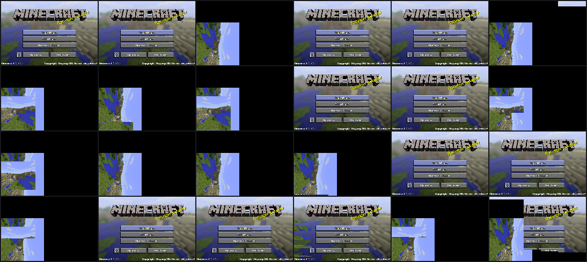
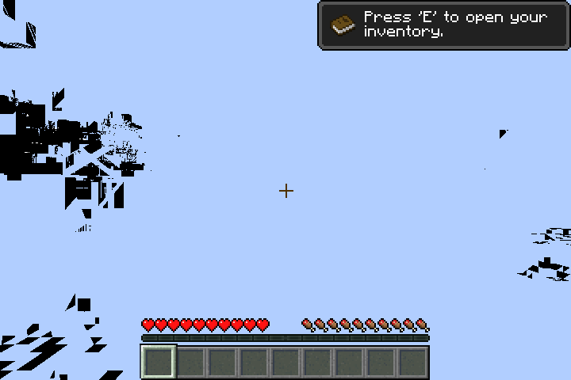
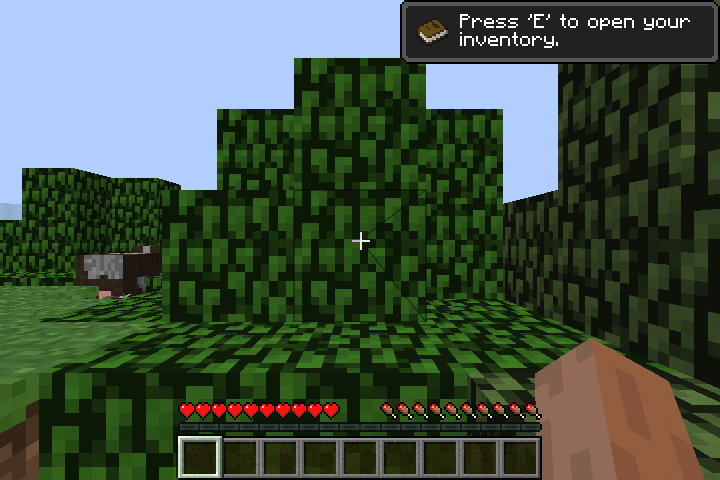

# Minecraft: the title screen, menus and a world's HUD on our driver

Next for milestone (e), after the first light: the game's own frames.

## The title screen

Ours drew the title screen's panorama, but the panel stayed black. The cause
was the openhc-minecraft overlay's alpha-only clear at every swap
(`glColorMask(0, 0, 0, 1)`, then `glClear`). Mesa 26 hands that to the
driver as a clear with a per-target colour mask, and the driver ignored the
mask, so it cleared RGB to black after every frame. Clears now honour it
(the colour-mask `sopwm` in the clear's pixel program, and ISPB). Fixed on
the way:

- **A depth-only clear wrote black colour.** It now writes no colour.
- **A mid-render depth clear to 1.0 was skipped.** It is now drawn; it was
  only right before anything else had been drawn.

With that, the whole title screen renders: the blurred panorama, the logo
and the buttons. Ours draws straight into fb0, single-buffered, so about half
of the panel dumps catch the next frame's panorama half drawn
(`img/…-title-1.png`). A back buffer and a blit at swap (the textures
session's present) will fix that.

## The menus, frame for frame

The game's own GL calls were recorded with apitrace (`mesa/tests/mcreplay.sh`
says how) and replayed on both stacks through gl4es. 2080 frames ran with no
SGX recovery: ours at 2.0 FPS, the DDK at 4.3. Every snapshotted frame is
byte-identical to the DDK's: the world list, Create New World, the loading
screens, the multiplayer screen, and the in-game error screen. Under the
tracer the game itself keeps failing to start the world ("Connection Lost:
ClassCastException: biz cannot be cast to fv", Minecraft's integrated server,
on the DDK too), so the recorded frames have no world in them yet.

## In a world

Live, ours gets into a world and draws its HUD (hotbar, hearts, the
inventory hint) correctly. The world itself comes out sky-coloured with dark
fragments, in framebuffer and in pbuffer mode alike; the DDK draws trees,
grass and a cow (`img/…-title-2.png` and `-3.png`, different worlds). Ruled
out so far, each byte-identical or within 1 level against the DDK on the
probe: exp and linear fog, alpha test on a texel (plain and dependent, with
the depth test), two textures in one shader (atlas plus lightmap).

## Also found

- **A DDK bug.** Two textures multiplied in one shader come out with R and B
  swapped in one of them on the DDK (red cells that no product of the texels
  can make). Ours gives the GL-correct product.
- **With gl4es' probe on** (as `gl4es-run` ships), gl4es renders the title
  into a framebuffer object. The driver can't draw into a texture yet (no
  sampleable render-target layout), so the panel shows only a gradient. That
  is the render-to-texture item, assigned to the textures session.
