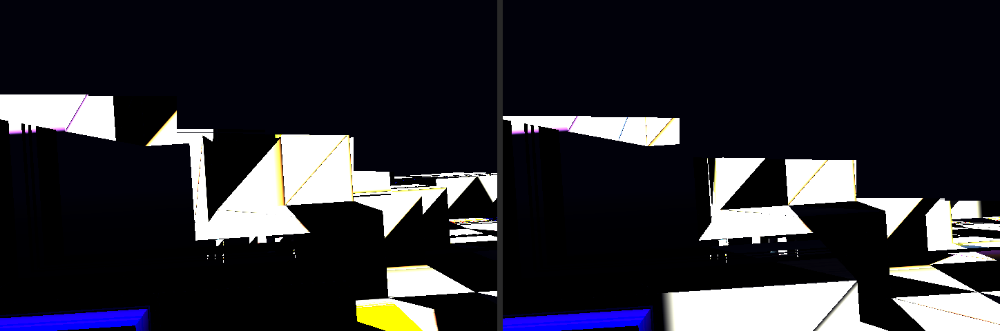
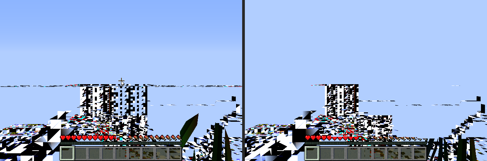
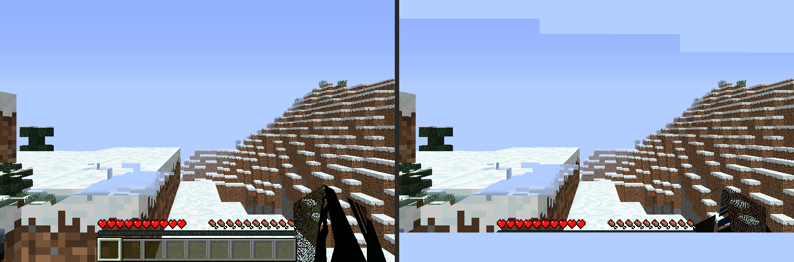
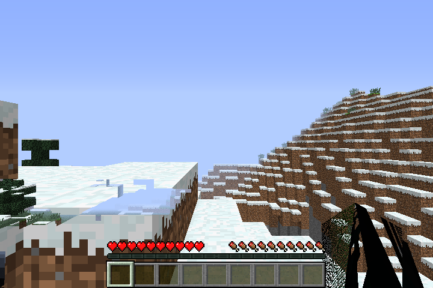

# Minecraft: a world on our driver, on the EA1

The driver work moved from the EA3 to the EA1. That is the box on the user's
monitor, the one that runs the game every day: Minecraft 1.7.10 with
OptiFine, through gl4es. A/B runs use a game directory of their own
(`MC_DIR=/opt/mc-ab`), so the player's saves are never touched. The clock
for the menu clicks starts when the game's log shows the menu
(`mc-ab.sh` `MC_READY`), so loading times don't matter. First, our
clear+triangle probe on the EA1: byte-identical to the DDK's reference
(md5 `232e4930`).

## Three runs into a new world

## What it took

1. **Texture sub-uploads re-twiddled the whole level.** Every
   `glTexSubImage2D` re-encoded the entire level into the texture heap,
   texel by texel, with scattered writes into write-combined memory.
   OptiFine builds a 1024×512 block atlas from hundreds of 16×16 sprites.
   Loading it took 73 s on ours against under 1 s on the DDK, and the game
   animates sprites in that atlas every tick. A transfer now encodes only
   its box. A twiddled tile the box covers whole is assembled on the stack
   and written in one go. An exhaustive check against the old per-texel
   formula passes (8 level sizes, 1-4 bytes per texel, random boxes). On
   the GPU, 9 texture cases are byte-identical before and after (`151c2e2`).
2. **st's packed varyings.** gl4es' terrain shader passes two vec3 texture
   coordinates and the fog. st packs them into slots named after what they
   hold (`packed:tc0,tc1`), so the second texture coordinate is named by two
   slots. The compiler finds a varying's set by name. The vertex program
   wrote the second slot over the first (`mov o8 … rpt=4`, then
   `mov o8 … rpt=3`), and the second set was never written. Every vertex
   then carried garbage texture coordinates, and the terrain came out black
   and white per triangle. The driver now names each varying after its slot,
   the same in both stages. Three packed layouts (vec3 + vec3 + float, four
   vec2) match the DDK within 1 level per channel: our F32 iteration
   against its F16. (`fca3d0b`, `mesa/tests/sgx545_varyab.sh`)
3. **Constants in the compiler's formats:** F16 halves and C10 channels
   (lowp), from the merged compiler's list C. Dynamically indexed uniforms
   now have their offsets in components, as the compiler reads them
   (`c9eef48`, `fca3d0b`).

No SGX recovery in any run on the EA1.

## Numbers

| | DDK | ours |
|---|---|---|
| block atlas load (1024×512) | < 1 s | 73 s, then < 1 s |
| in-world FPS, render distance 3 (gl4es counter) | ~42 (the runtime launcher's note, EA1) | 4.5-5.8 |

## Still open

- The player's arm (entity lighting shader) is black.
- Ours draws into fb0, single-buffered, so frames tear. The textures
  session's present (a back buffer and a blit at swap) fixes that.
- Performance: an order of magnitude behind the DDK. Vertices are fetched
  and expanded on the CPU per draw, and textured draws aren't batched.
- gl4es with its probe on renders into FBOs (render to texture): not
  integrated yet, so the game runs with `LIBGL_NOTEST=1`.
