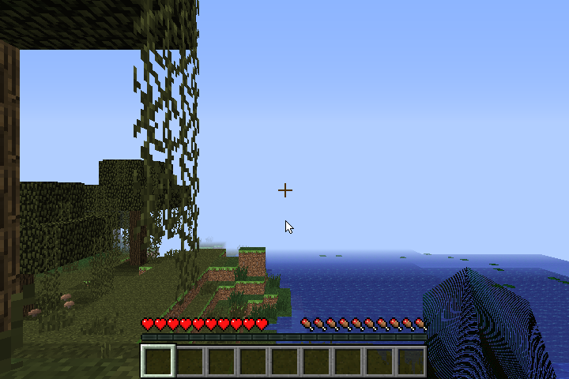
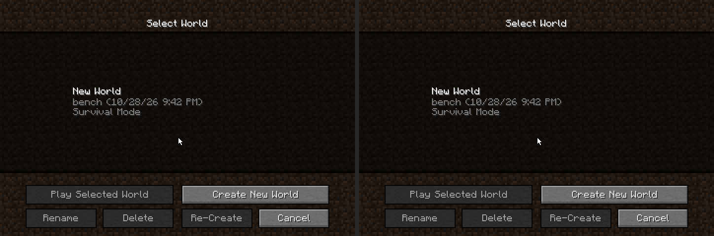
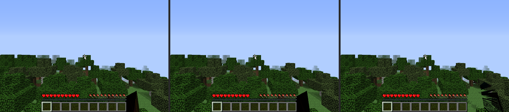

# Minecraft on our driver: no flicker, and about twice as fast

After first light in a world (entry `2026-10-28-2100-minecraft-world-ea1`), the
user watched it on the EA1's monitor. The panel flickered, and the title
screen seemed to redraw, rotate and scale. Ours was also several times slower
than the DDK.

## Measuring like for like

Every earlier run created a new random world, so frame rates weren't
comparable. The rig now restores one saved world before each run
(`/opt/mc-ab/bench-world`, `mesa/tests/mc-ab.sh` + the bench script) and
enters it the same way on both stacks.
- Menus poll the mouse button, so a click has to be held across a frame
  (`mousedown`, `mouseup` a second later).
- `SGX545_STATS=1` prints, every 2 s: FPS, draws, vertices, flushes and why
  they happened, the driver's CPU time, its time submitting and waiting, and
  the render thread's own CPU time.

In the bench world the DDK runs at **28-37 FPS**.

| step | ours, FPS | what changed |
|---|---|---|
| first light | 4.5-5.8 | (random world) |
| indexed draws | 10-11 (random world) | each vertex fetched once, 16-bit indices for the VDM, per-format fetch loops (`c90a62d`) |
| bench world, start | 6-9 | |
| back buffer + swap blit | same | no more half-drawn frames on the panel (`5ab2431`) |
| frames overlap the GPU, textures ghosted | same in the bench, es2gears 217 -> 252 | (`e246ff4`) |
| texture reads by the PDS | 8-10 | (`81a4bb4`) |
| client arrays in place, wait backoff | ~10.5, es2gears 269 | (`ea05aab`) |

## What each fix was

- **Flicker** (`5ab2431`). The fbdev window rendered straight into `/dev/fb0`,
  so the panel showed every step of a frame. Minecraft's title screen draws
  its panorama small, copies it and blurs it seven times, then stretches it
  over the screen: that was the "rotating and scaling". Windows now render
  into a back buffer. `eglSwapBuffers` copies it to fb0 with a GPU blit (Mesa's
  u_blitter through our own shaders) that samples the back buffer in place,
  as the DDK's swap does (strided layout 6, pitch 736). fb0 after the swap
  equals the frame, 0 of 345,600 pixels off. fb0 is simplefb and can't pan,
  so there is no flipping.

  

- **A stale program in every masked clear** (`957dbd7`). The clear's
  colour-masked PDS programs were made on first use, in frame memory that the
  next frame overwrote. The openhc-minecraft overlay clears alpha at every
  swap, so from the second frame on it ran whatever was there. They are now
  made with the context. This is a candidate for the menus' one SGX recovery.
- **Overlap** (`e246ff4`). A submitted frame isn't waited for any more:
  - three ring slots, one render in flight per target;
  - the back buffer and fb0 have targets of their own;
  - the CPU waits only where it reads a target.

  A texture written while a render may still sample it switches to a second
  device copy, brought up to date from the CPU copy, as the DDK's ghosting
  does. Minecraft animates its block atlas every tick.
- **Fragment shaders were half the GPU time.** With constant-colour shaders
  the GPU's time per frame halved. Both terrain texture reads were dependent
  samples (`frcp`, `fmad`, `smp`, `wdf`). Three things stood between them and
  the PDS (`81a4bb4`):
  - st packed varyings;
  - the GL linker's varying optimisation put the fog in front of a texture
    coordinate;
  - the compiler's matcher only knew `load_interpolated_input`.

  The terrain shader now reads both texels from PA (`nondep proj`), as the
  DDK's does. `sgx545_texproj.sh`: 3 cases byte-identical to the DDK.

## Where the frame goes now

| | per frame |
|---|---|
| GPU, synchronous (`SGX545_SYNC=1`) | ~35 ms, of which fragment shading ~18 ms |
| render thread CPU | ~57 ms |
| driver draw path | ~19 ms |
| 1000 tiny draws per frame, cost per draw | 16 us ours, 13 us DDK |

The render thread's CPU is the limit. A profile of that thread:
- kernel ~25%;
- Mesa's state tracker and our driver ~24%;
- the game's code ~19%;
- gl4es ~15%;
- libc ~8%.

## Still open

- The player's arm (entity lighting) is drawn wrong: dark and streaky.
- CPU per frame: Mesa's per-draw validation, our vertex gathering, kernel
  entries. The DDK's whole frame is 33 ms.
- F16/C10 arithmetic (`opts.f16`), as the DDK computes mediump and lowp.
- One SGX recovery in the menus earlier; the DDK had one too in the same
  session.
