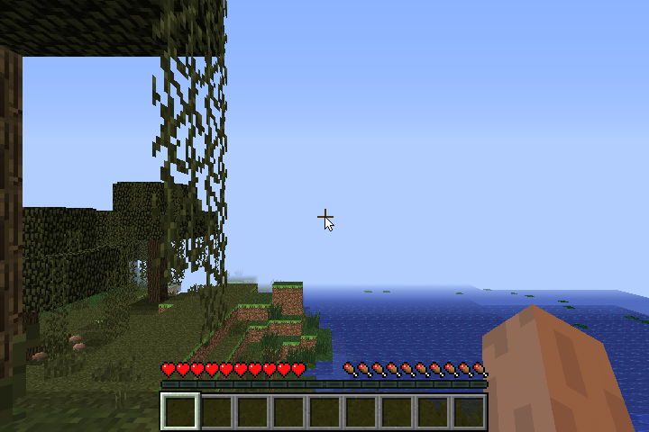

# Minecraft: the arm, and 21-23 FPS

## The arm

The player's arm came out black, with a moire of the world showing through it.
- Its shader was fine: the uniforms (dumped with the driver's
  `SGX545_DEBUG_ATTRS`) were sensible, and so were the vertex inputs.
- The pattern was the alpha test cutting holes at garbage texture coordinates,
  in a pitch-black lit colour.
- Lit entities are the first vertices with five attributes, 20 dwords. The
  vertex fetch moved a vertex with one DMA, and a DMA longer than 16 dwords
  loses what comes after (the constants' DMAs were already chunked at 16 for
  that reason). The fetch now DMAs at most 16 dwords at a time (`cb287df`).

Ruled out on the way, each with a test against the DDK on the EA1, all
byte-identical:
- non-square twiddled textures (`sgx545_texshape.sh`, 7 shapes);
- triangles crossing the eye plane (`sgx545_nearclip.sh`);
- 5 and 6 attributes (`sgx545_attrs.sh`, within one level: F32 against F16).

Found on the way: 128 or more floats of vertex uniforms don't compile yet
(`sgx545_uniforms.sh`); the DDK takes 192.

## The allocator

With the vertex cache in, a profile of the render thread showed 59% in the
kernel, over a third in the services' `_SegmentListInsert`. Every cache entry
was a device allocation of its own, and with hundreds alive each new one
walked a long list. Entries are now cut from 2 MB chunks (`741ef84`).

| | ours, bench world |
|---|---|
| before | 16-19 FPS |
| chunked cache | **21-23 FPS** |
| the DDK, same world | 28-39 FPS |

The render thread is on the CPU ~60% of the time now and waits for the GPU
again.

## F16

F16/C10 shading is wired in behind `SGX545_F16=1` (`759f6a6`). It isn't on by
default yet: the compiler made a constant 1.0 come out 0, and the driver's
mediump varyings were iterated F32. The compiler session has fixed both (its
`2664fec`).
