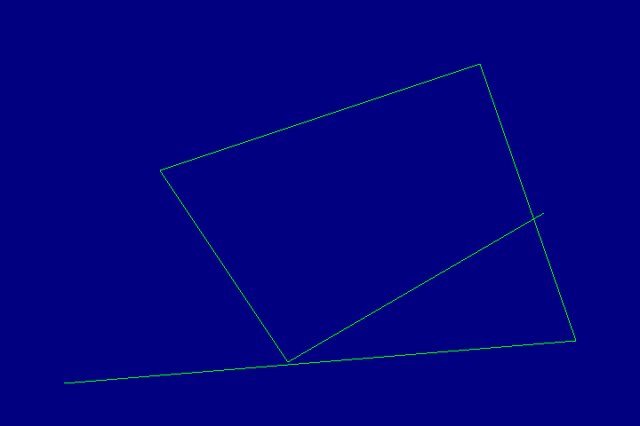
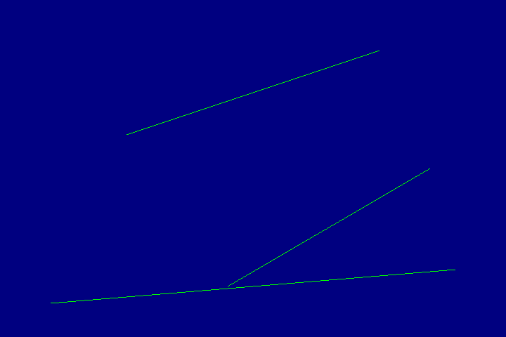
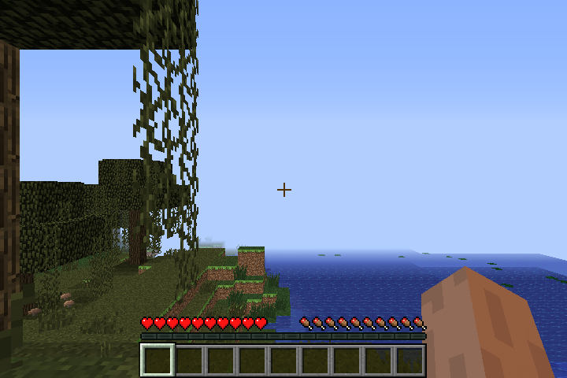

# The night's M0 features, A/B against the DDK on the EA-1

Every feature below was built from docs/ and the night's DDK captures, then
drawn by the probe on both stacks on the EA-1 (`mesa/tests/sgx545_featureab.sh`)
and compared byte for byte, one case at a time, with no SGX recovery all night.

| feature | cases | result |
|---|---|---|
| scissor, partial viewports (pass-type-3 objects, region clip) | 11 | all identical, after the two pbuffer cases moved to an 8888 config (the default 565 pbuffer rounds) |
| stencil, one- and two-sided | 6 | identical |
| constant-color blending (the sopwm form), add, subtract, reverse subtract, under a color mask | 7 | identical |
| gl_FragCoord (DOUTI source 0) | 2 | identical |
| gl_FrontFacing (the compiler's g16 test) | 4: both windings in one draw, both glFrontFace settings, window and pbuffer | identical |
| lines: lists, loops, widths 4 and 9.5 | 4 | identical |
| line strips | 1 | differs, and the DDK is the one that's wrong: it draws two stray lines (STATE.md "Lines and points") |
| render to texture: RGBA8888 twiddled and NPOT, with depth, with depth-stencil | 4 | identical |
| render to texture: 565, 4444, 5551 | 3 | differ in the clear's 170094 pixels: ours stores them as RGBA8 and doesn't round the clear color |
| cube maps (T1 layout 2), with mipmaps, dependent reads | 4 | identical |

What the captures settled (docs/PDS.md, STATE.md, ISA.md): gl_FragCoord is
DOUTI source 0 (x, y at pixel centers in memory order, z, 1/w); cube maps are T1
layout 2; a two-sided stencil block carries both faces' ISPA with b11, and the
first group is the back of gallium's front_ccw; gl_FrontFacing is bit 0 of g16.

Two bugs the A/B caught before they shipped: gl_FrontFacing and two-sided
stencil came out with the faces swapped (the sense is now from the A/B, not the
capture alone), and the first render-to-texture deadlocked on the screen lock
(a CPU hang, no GPU involvement).

Points and sprites wait for the EA3, which has a plug: the point-size output's
format is the least certain new path.

## Minecraft

The bench world, 170 s per run: ours 32-35 FPS through the night's builds, the
DDK 40-41. Two runs in the middle came out at 23-29; the same build ran at 34
before and after, and its programs were byte-identical, so they were the box,
not the driver (cause not found).

