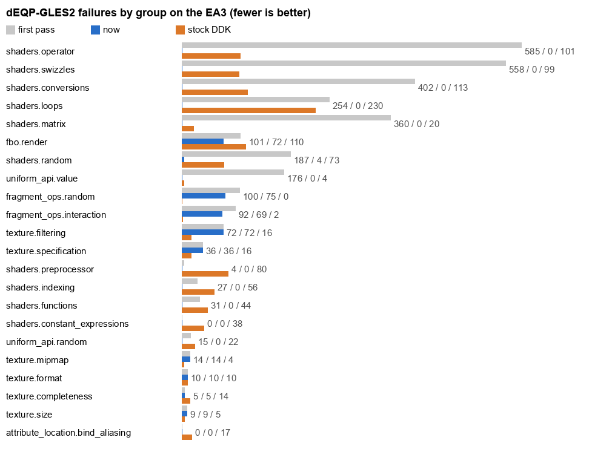

# dEQP-GLES2 on the EAs: 96.6%, and the stock DDK 92.3%

The first full conformance runs of the open driver, and of the DDK it replaces, on the
same EA3, kernel (#124 RAM image) and dEQP build: VK-GL-CTS 4.6.8.0 dEQP-GLES2, 17,165
tests, surfaceless pbuffer 256×256 `rgba8888d24s8`, deqp-runner 0.23.2.
`mesa/tests/deqp/drive-deqp.py` sends 200 tests at a time from the Mac, checks each chunk
with a one-draw canary and power-cycles the box through the Bench plug when a chunk
leaves the GPU stuck.

| | pass | fail | crash | timeout | not supported |
|---|---|---|---|---|---|
| ours, first pass | 13,592 (79.2%) | 3,075 | 35 | 1 | 445 |
| ours, now | **16,574 (96.6%)** | 142 | 0 | 0 | 445 |
| stock DDK (Cedarview 1.7, i386 under IA32) | 15,837 (92.3%) | 1,146 | 11 | 8 | 124 |

"Now" is the first pass with the failing tests rerun on each later build (up to um-re
c76d83e on the EA3, then on the EA1, which took over GPU testing that evening, up to
um-re 4c8e51a), not a second full pass. 1-in-4 samples of the whole suite on two of the later
builds found nothing new beyond order-dependent `fbo.render` cases (they fail after other FBO
tests and pass alone; listed as flakes) and an F16 uniform regression that was fixed the same morning (below). Data:
`data/2026-11-02-1530-deqp-gles2.csv`; expectations:
`mesa/src/gallium/drivers/sgx545/ci/sgx545-{fails,flakes,skips}.txt`, the DDK's in
`mesa/tests/deqp/ddk/`.

## What moved it

- The compiler session's fixes for loops, discard, `all`/`any`, operators (mediump
  scalar functions of vectors, `atan`'s integer copysign, texture bias, mediump
  sin/cos): 2,054 `shaders` tests outside `shaders.matrix`, including every
  `shaders.operator` case.
- Matrix attributes: Mesa splits a `mat2` attribute into one variable per column, every
  one named after the matrix, and the compiler placed attributes by name, so every column
  read column 0's registers. +391, all of `shaders.matrix`'s dynamic cases.
- Two-sided stencil: the 22-word state block was DMA'd with the single-sided block's 25
  dwords. Its draws came out blank or with wrong channels, and differently from one run
  to the next, which made it look like uninitialized memory. The DDK's capture reads
  27 dwords for this block; 27 and 28 work, 24 and 25 don't (STATE.md). +45 in
  `fragment_ops`.
- Blends with SUBTRACT on one side and REVERSE_SUBTRACT on the other. The blend
  instruction subtracts in one direction for color and alpha both, so the driver turned
  such blends off, and every `fragment_ops.random` and `interaction` case that drew with
  one came out wrong. The constant-factor form multiplies each side into r0 and r1 before
  the subtract; putting the alpha products in the other register reverses alpha alone.
  +144, all of `fragment_ops`. The extra blend variants then filled the 256 KB pixel
  program ring (now 1 MB, 32 variants a shader).
- Cube maps: the sampler spaces faces by their mip chain rounded up to 0x800 bytes in
  every format (we rounded to a 16×16 tile's bytes, right for RGBA only), and by level 0
  alone when it samples without mipmapping, so a cube with levels sampled with LINEAR
  read every face but +X from the wrong place. DDK captures on the EA1 gave both: its
  buffer for a 16×16 RGBA cube is 0x3000 bytes with mipmapping and 0x1800 without. The
  driver keeps a copy of the level-0 faces for the second case. +83.
- RGB render textures: sampling one reads its X byte as alpha, and draws and scissored
  clears wrote the color's alpha there. The texture starts at 0xff and draws into it
  blend to keep the tile's alpha.
- FBO crashes (a target destroyed while its frame was recorded), X-alpha clears, culling
  both faces, constant-alpha blending.

## Where each one fails

The DDK loses most of its tests in its shader compiler (loops 230, conversions 113,
swizzles 99, operators 83, preprocessor 80, indexing 56): 864 of its 1,165 failures.
Its compiler never returns on dEQP's recursive macros; those ten tests took the box down
seven times, so they're in `ddk-skips.txt`.

Ours (142, of which some `fbo.render` cases are order-dependent: they fail after other
FBO tests and pass in their own group):

- Cube maps: 58. Nearly all NPOT faces, which have no cube layout: the DDK samples a
  12×12 cube as one linear face and fails every NPOT cube test. Then cube LOD bias (4),
  as in 2-D, and a few 16-bit and copied faces.
- `fbo.render`: 59. The shared and recreated color buffers fail on the DDK as well;
  ours also stores 565/4444/5551 targets as RGBA8.
- Compiler: none left. The last four (`all_features` 5/20/32/88) were a value stored to
  a register in a branch, never copied when a texture sample produced it (um-re c76d83e).
  Every test that failed only on the F16 path passes too. Fixes from the last rounds: a mediump value widened to f32 for the color was never written when it went into a
  register (an F16 result reached the color pack as raw bits, or the register kept
  stale data); fixed in um-re 9cc3bb4, +14; and an F16 constant fed to a widening was read as f32
  bits (a denormal, so 0: log2 of 2.0 became log2 of 0), fixed in 269889a, +7. Earlier the same day a regression on
  that path was fixed: four `shaders.linkage.uniform_struct_*` cases that
  passed in the first pass failed from the 05:06 compiler merge on. An F16 uniform read
  as a whole pair took its neighbor's register (sa8 for sa10's high half). And a
  `mediump mat4[3]` put F16 constants past sa31, which a format-select operand can't
  reach, so the eight `uniform_api.value.initial` shaders never compiled. Both are fixed
  in the compiler (um-re 9e1f2c1), +13.
- Small groups: polygon offset (the bias is per render in the render details, the tests
  change it between draws), wide lines (the DDK fails them too), points from
  `glDrawElements` (the DDK fails them too), a depth+stencil clear, and
  `max_vertex_uniform_vectors` (120: Mesa keeps 8 for clip planes).

The SGX hardware recovered about 70 times during the night's runs without a wedge; the
two-sided block is the likely source of many of them.
