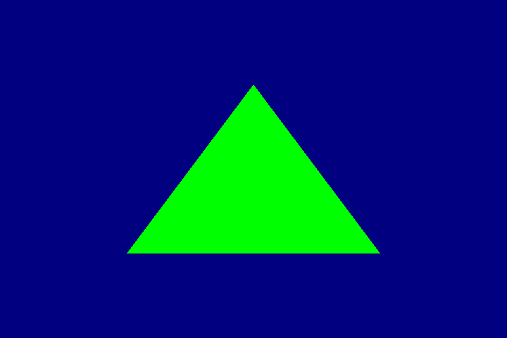
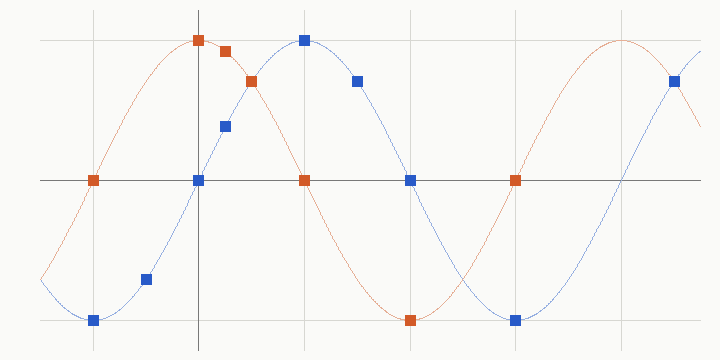

# USSE ISA: the driver's discard path, the vertex output layout, and 442 instructions checked on the GPU

By the evening of 2026-10-27 the SGX545's shader instruction set was decoded
from libusc's own assembler: all 4154 words of three compiled corpora decoded
with no unexplained bit, checked against ~20,000 encodings from that assembler
run in an emulator. That told us where every bit is, but many *meanings* were
still guesses: what `fadm` computes, which source `fminmax` clamps against,
what the hardware constant table holds, how F16 operands are numbered. And
three questions sat outside the instruction set: how a pixel is actually
killed by `discard`, why writing `gl_PointSize` moved every varying by two
output registers, and what the USP container's header means.

Two sessions split the work on 2026-10-28, then everything was merged back
into `um-re`.

## The driver side (offline, libGLESv2 + libglslcompiler decompiles)

- **discard**: the compiled program only carries a `test` writing the
  keep-predicate p1 and a lone `nop` between two labels. At draw time the GLES
  driver turns a discarding shader into a two-phase program: `phas` +
  `pcoeff` at the start, the `nop` replaced by `atst8 ... [end]` (a word with
  a bit libusc's own assembler can never set), phase 1 starting at a label the
  USP header records. A compiler must emit the same visibility-test epilogue
  itself. Points and lines take a different path that, as compiled, stores
  its `(p1) depthf` words on the CPU stack instead of in the program: it looks
  broken in the shipped driver.
- **vertex outputs**: position o0-o3, then texture-coordinate sets 0-9 with no
  gaps, then point size. Writing `gl_PointSize` makes libglslcompiler reserve
  set 0 (two components, o4-o5) before the varyings and never write it; most
  likely the point-sprite coordinate.
- **USP header**: every field 0x10-0x83 named from the writer and the
  loader; `usp.py` now sizes every list from the header instead of by fit.

## The GPU side: `hwt.py`

`hwt.py` turns the frame replayer into an instruction tester. It pokes a
hand-assembled main pixel program into the replayed frame (image 1 is the
replayed frame the tests start from), loads inputs with `limm`, runs the
instruction under test and ends with `mov o0, rN [end]`. The pixel back end
stores o0 unchanged, so a pixel inside the triangle *is* the 32-bit result
register: one draw, one register read back exactly. (The tests clear to a
known colour, 0.2/0.4/0.6/0.8, so a program that never ran is obvious.)

442 tests in 8 suites, about 440 draws on the EA3, then a full second run
that matched the first bit for bit. No GPU hang, no SGX recovery, no reboot.
93 tests had an expected result (an exact word or a check) and all 93
matched; the other 349 recorded a value to establish a fact (what does `fmsa` compute? what is c46?).

Image 3 is the whole run as the back buffer saw it: one block per test, its
result word shown as the pixel the hardware wrote (B, G, R bytes), suites in
order (sanity, ba, p1 ... p6). The near-black rows in p2 are the movc and
test results, which write the marker words 0x11111111 / 0x22222222.

What it settled (all now tagged **hardware** in ISA.md):

| question | answer |
|---|---|
| fadm, fmsa, fsubflr | (a+b)·c, a·a + b·c, a − floor(b) |
| fminmax / fmaxmin | min(max(a,b),c) / max(min(a,c),b) |
| fsin / fcos | sin/cos(t·π/2): the argument is in quarter turns |
| inc0/inc1/inc2, moe | step src0/1/2 only; moe steps all three; dst always steps |
| F16 operands under format select | **the number counts 16-bit halves**: F16 sources reach r0-r31 only |
| scalar op bit h2 | F16 destination (the other half is zeroed) |
| hardware constants | as libusc says, except c46/c47 = F16 (1,1) and c57-c63 exist |
| movc types | u8/i16/c10 select per byte / half / 10-bit channel, signed |
| pck rounding | 0 nearest-even, 1 down, 2 up, 3 zero; f32→f16 always truncates |
| fmad16 swizzles | (lo,hi), (lo,lo), (hi,hi), f32 converted |
| branches | `br #n` = this + n; `ba` = absolute index |
| setfc | second argument = colour-class C10 enable, on at task start |

The quarter-turn finding is the kind of thing a compiler gets silently wrong.
Image 2 plots the hardware `fsin` (blue squares) and `fcos` (orange) results
over t from −1.5 to 4.75 against sin(t·π/2) and cos(t·π/2): every point sits
on the curve, worst error 2.1e-5 (about 16 bits).

## Three whole frames

The hwt run itself kept only 32 result pixels per test, so afterwards the
same session drew three tests again and saved the whole back buffer
(`hwt.py hwt_frames --full`, suite `re/isa/hwt_frames.py`, commit 974a9d4 in
its clone). Each frame is 720×480 visible pixels and holds exactly two
values: 302,400 background pixels at the clear colour 0xcc336699 and 43,200
triangle pixels, every one of them the result word bit for bit. The PNGs show
the stored B, G, R bytes of that word with alpha forced opaque: these pixels
are register contents, not colours.

| frame | program | triangle word | meaning |
|---|---|---|---|
| image 4 | the captured `mov o0, sa9` (no test) | 0xff00ff00 | the uniform colour, green |
| image 5 | `fmad_plain` | 0xc1b40000 | f32 −22.5, the fmad result |
| image 6 | `br_2` | 0x00000055 | r5 of the branch's landing pad: `br #2` skipped one instruction |

## What didn't work, or is still open

- Not yet drawn: call/`lapc`, efo, the integer classes, the bitwise ops (a
  `bit_*` suite was running on the box while this was written), fdp/fddp and
  dual issue. The `atst8` kill predicate (p1) is read from driver code only.
- Why the pack rounding mode doesn't reach f32→f16, and the alpha byte of a
  32-bit C10 source (came back 0xff).

## Merging

Three lines of `um-re` (the ISA session at 6cfc555, the finalizer at
579240f, the hardware checks at 3755f9b) merged with two small ISA.md
conflicts, both "each side added different evidence for the same field".
Then the decoder took the hardware's word: `dis.py` now prints an F16
source as the half it reads (`pa1.lo` / `pa1.hi`, encoded number
2·reg + half; a later merge settled on the hardware session's
`pa1.f16.lo` / `pa1.f16.hi`), and scalar h2 as `f16d`. After the merge: 4154/4154 corpus
words decode and round-trip, oracle sweeps 3340 + 1579 + 1602 + 13,441
encodings, 0 failures.

Commits: ca49cc4 (merge finalizer), 2321815 (merge hardware checks), def0390
(decoder corrections). Data: `../data/2026-10-28-0656-usse-isa-merge.csv`
(all 442 results: suite, test, word, f32, f16 pair, checked/recorded) and
`.json` (counts, the fsin/fcos points and errors, md5s of the `hwt_out` logs).
