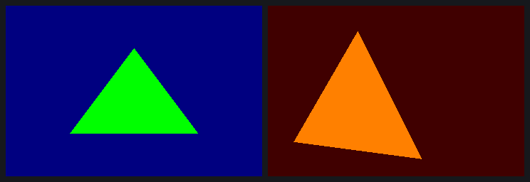
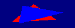
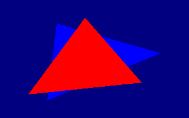

# A frame from code alone: no captured bytes, pixel-exact

Until this morning, every frame the open userspace drew started from a capture
of the blob. The replayer loaded the DDK's memory image and changed words in
it. Our init code, our shaders and our state words were all poked into
someone else's frame. The goal of this step: build every buffer of a frame
from GL-level parameters, using only what `STATE.md`, `PDS.md` and `ISA.md`
say. Nothing would be read from a capture.

The result is `re/gen` (commit `88dfc68`, then this entry's commit), and
`re/gen/GEN.md` documents it:

- `sgxgen.c`, a C library shaped like what a gallium driver needs underneath
  it (context, surface, shader, state, clear, draw, flush);
- `mkusse.py`, which assembles the fixed USSE programs from text with
  `re/isa`'s encoder;
- `frame`, a static x86_64 program;
- `fakepvr.c`, a fake kernel driver, so a frame can be generated and decoded
  without a GPU.

## How it was checked before it touched the GPU

The bridge client `re/replay/pvr.c` learned to write pvrtrace logs of its own
runs, and `mkreplay.py` learned to read x86_64 traces. So a generated frame
can be read by the same decoders as a blob capture.

- **On the fake driver.** `frame-fake` ran on the EA3 without opening the GPU.
  Its trace went through `state/decode.py` and `pds/dis.py`.
- **Against the reference.** A pairwise comparison followed the same
  pointers through the generated frame and through `ref.bin`. That covers the
  TA command, the render details, the RT data, the PB, the free list (1058
  words), the background block, all 13 PDS programs, the VDM stream, the TA
  blocks, the vertex data, the uniforms and all 16 USSE programs.
- **What differed.** Only words that hold an address: the end-of-tile LIMM of
  the render target address, the `phas` targets, a few pointers.

## What still went wrong on the GPU

**1. A missing vertex epilogue.** The first generated frame locked up the TA.
A finalised vertex program has a third phase that the previous one's
`phas.i` points to:

    phas.i #0, #0 [wait=7]
    emit.t1 r0, #0, #0 [end f12 f10 f3_20]

The source text in `mkusse.py` had been checked against the capture only up to
the first `end` bit, so this third phase was missing. The vertex task jumped
into zeros. The fix is `VS_EPILOGUE`.

**2. The microkernel remembers the previous client.** The frame still hung
after a replay. It was fine on a fresh boot: **md5 `56f8466a…`, the reference
frame, bit for bit**, at about 08:15 UTC. It was also fine after itself. It
hung only after a client with a different memory layout.

The SGX recovery dump showed why. The TA/3D control block still pointed at
the previous client's render details (`0x3200e560`) and RT data entry
(`0x3200ab10`). The microkernel reads those when the next TA starts. In our
layout those addresses held something else.

- **The obvious fix failed.** The DDK's own teardown sends
  `SGX_FLUSH_HW_RENDER_TARGET`. Sending it timed out ("Wait for uKernel to
  clean up (1) failed") and wedged the GPU.
- **What worked was the DDK's layout.** sgxgen now allocates kernel-data and
  sync memory in the DDK's exact order: dummy transfer contexts, then three
  render-details sets. Every structure lands at the DDK's address.
- **Proof:** replay → frame and frame → replay, both pixel-exact, and the blob
  probe interleaved with frames all through the test run below.

## Variations

`re/gen/vary.py` checks each case against the blob, which draws each triangle
on its own in the probe. The prediction composes those images in the case's
priority order. Every case: **0 pixels differ**.

Top row:

- two draws, no depth test;
- LESS with the near triangle drawn first;
- LESS with depth writes off.

Bottom row:

- GREATER against the 1.0 background (nothing passes);
- LESS with the far triangle first;
- `glViewport(100, 50, 400, 300)`.

The same machinery handles other surface sizes. Below are two y-up (pbuffer
layout) surfaces checked against the blob's pbuffers: 128×48 with two draws
(2×2 macrotile mode), and 320×200 with the depth pair.

 

| case | pixels | differ |
|---|---|---|
| ref | 345600 | 0 |
| colors | 345600 | 0 |
| two | 345600 | 0 |
| depth | 345600 | 0 |
| depth-far-first | 345600 | 0 |
| depth-nowrite | 345600 | 0 |
| depth-greater | 345600 | 0 |
| viewport | 345600 | 0 |
| pb128x48 | 6144 | 0 |
| pb320x200 | 64000 | 0 |

Raw results: `data/2026-10-28-0830-frame-from-code.json`.

## Cost

The EA3 was power-cycled three times (`data/story-power-cycles.csv`):

- after the epilogue hang;
- after the layout hang;
- after the RT flush.

Each time the GPU was brought back up by `re/srvinit`, with no blob. Every
SGX recovery came before the two fixes. The test run after them (10 generated
frames, 15 blob probe runs and a replay, interleaved) had none.

## Next

- The generator takes shaders as `sgx_shader` structs. The NIR compiler
  backend can fill them.
- Then textures, blending, scissor, and more than one frame per context.
- Then Mesa.
